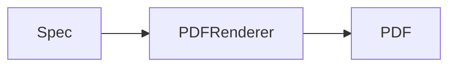

# Documentation site

The json-render for Swift docs, built with [Astro](https://astro.build) and
[Starlight](https://starlight.astro.build). Pages are MDX files in `src/content/docs/`; the sidebar
is defined in `astro.config.mjs`.

## Commands

Run from the repository root:

```sh
pnpm docs:dev       # dev server with live reload
pnpm docs:build     # static site in apps/docs/dist
pnpm docs:preview   # serve the built site
```

`pnpm --filter "@json-render/swift-docs..." build` builds only this package, which is all the build
needs. It runs no Swift or Xcode steps.

## What the build reads from the repository

The site doesn't copy content that lives elsewhere in the repo. It reads it at build time:

| Input | Used by |
|---|---|
| `packages/swift/src/catalog.ts`, `pdf.ts`, `pdf-forms.ts` | The component, action and check tables (`src/lib/catalog.ts`, `ComponentTable`, `ActionTable`, `CheckTable`) |
| `fixtures/specs/*`, `fixtures/pdf/*.json(l)` | Spec and stream excerpts (`RepoFile`) |
| `docs/system-prompt.sample.txt`, `docs/system-prompt-pdf.sample.txt` | Prompt excerpts (`RepoFile`) |
| `docs/screenshots/*.png`, `docs/screenshots/pdf/*.png` | Demo-app and PDF page images (`Screenshot`), optimised at build time |

Regenerate those inputs where they're produced (for example `pnpm --filter @json-render/swift gen:prompt`),
then rebuild the site.

## Base path and links

The site is built with `base: "/json-render-swift"`, so it is served from `/json-render-swift/`.
Internal links in MDX carry the prefix:

```md
[Specs](/json-render-swift/specs/)
<LinkCard title="Quick Start" href="/json-render-swift/quick-start/" />
```

`starlight-links-validator` checks every internal link and heading anchor during `pnpm docs:build`,
and the build fails on a link without the prefix or an anchor that doesn't exist. Components that
build URLs use `import.meta.env.BASE_URL`.

## Diagrams

Write flow, sequence, state and architecture diagrams as Mermaid code blocks:

````md

````

`astro-mermaid` renders them in the browser and follows the light/dark theme. File trees can stay as
`<FileTree>` or plain code blocks.
