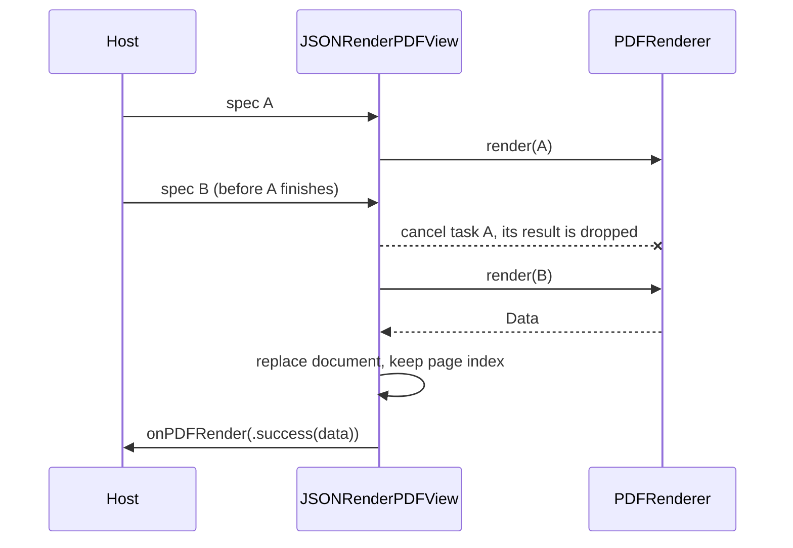

import { Aside } from "@astrojs/starlight/components";

`JSONRenderPDFView` renders a spec with [`PDFRenderer`](/json-render-swift/api/swift/pdf-renderer/) and shows the result in a PDFKit `PDFView`. It re-renders whenever the spec changes and keeps the previous document on screen until the new one is ready, which suits a spec that streams in from a model.

## JSONRenderPDFView

```swift
public struct JSONRenderPDFView: View {
    public init(spec: Spec?, options: PDFRenderer.Options = PDFRenderer.Options(), id: AnyHashable? = nil)

    public func onPDFRender(_ action: @escaping @MainActor (Result<Data, Error>) -> Void) -> JSONRenderPDFView

    public var body: some View { get }
}
```

```swift title="InvoicePreview.swift"
import JSONRenderPDF
import JSONRenderSwiftUI
import SwiftUI

struct InvoicePreview: View {
    let spec: Spec

    var body: some View {
        JSONRenderPDFView(spec: spec)
            .navigationTitle("Invoice")
    }
}
```

### init(spec:options:id:)

```swift
public init(spec: Spec?, options: PDFRenderer.Options = PDFRenderer.Options(), id: AnyHashable? = nil)
```

| Parameter | Type | Description |
|---|---|---|
| `spec` | `Spec?` | The spec to render. `nil` clears the view. Partial specs render; see [Partial and empty specs](/json-render-swift/api/swift/pdf-renderer/#partial-and-empty-specs). |
| `options` | [`PDFRenderer.Options`](/json-render-swift/api/swift/pdf-renderer/#options) | State overrides, image loader, image timeout, image limits and page cap for every render. |
| `id` | `AnyHashable?` | Changing it forces a re-render. Use it for option changes the view can't compare, such as a different image loader. Default `nil`. |

### onPDFRender(_:)

```swift
public func onPDFRender(_ action: @escaping @MainActor (Result<Data, Error>) -> Void) -> JSONRenderPDFView
```

Sets a closure that runs on the main actor after every render attempt that completes, with the PDF bytes or the error. Use it to keep the bytes for sharing or saving, or to report errors. It isn't called:

- for a render that was cancelled because the spec changed again or the view went away;
- when `spec` is `nil`.

Calling `onPDFRender` again replaces the previous closure. It is a method on `JSONRenderPDFView`, not a view modifier, so call it directly on the view, before other modifiers.

## Behaviour

- **Rendering runs in a task.** The view renders in a `.task` keyed by `spec`, `options.state`, `options.imageTimeout`, `options.imageLimits`, `options.maxPages` and `id`. A render starts when the view appears and whenever one of these changes to a value that isn't equal (`Spec` is `Hashable` over its parsed fields and raw JSON). The render itself runs off the main actor.
- **A new spec cancels the old render.** When `spec` changes while a render is running, SwiftUI cancels that task. The cancelled render still finishes its layout, but its result is dropped: the document isn't replaced and `onPDFRender` isn't called. The view also cancels the task when it disappears.
- **The last good document stays.** While a render runs, the previous document stays on screen. When a render fails, the previous document stays and `onPDFRender` receives the error. Before the first successful render, the view is empty.
- **The reader's page is kept.** When a new document replaces the old one, the view goes to the same page index, or to the last page when the new document is shorter. A reader on the first page stays at the top.
- **`nil` clears.** Setting `spec` to `nil` removes the document at once.
- **What doesn't trigger a render.** `options.imageLoader` and the `onPDFRender` closure aren't compared, so changing only them doesn't re-render; change `id` to force one. Each render uses the values from the view that started it.



### PDFView configuration

The wrapped `PDFView` is created once with:

| Property | Value |
|---|---|
| `autoScales` | `true`: the page scales to fit the view's width. |
| `displayMode` | `.singlePageContinuous`: pages in one scrolling column. |
| `displayDirection` | `.vertical` |

On iOS the view is a `UIViewRepresentable`; on macOS an `NSViewRepresentable`. The `PDFView` isn't exposed. For other settings (thumbnails, page breaks, annotations, selection handling), render with `PDFRenderer.document(for:)` and host your own `PDFView`.

## Streaming

Each render lays out the whole document again, so re-rendering on every streamed patch wastes work and makes the preview flicker between partial states. Debouncing is the host's job: update the spec you pass to the view at most about once a second while patches arrive, then once more with the final spec.

```swift title="DocumentGenerator.swift"
import JSONRenderPDF
import JSONRenderSwiftUI
import Observation

@MainActor
@Observable
final class DocumentGenerator {
    private(set) var previewSpec: Spec?
    private let bridge: JSONRenderBridge

    init(bridge: JSONRenderBridge) {
        self.bridge = bridge
    }

    func generate(_ chunks: some AsyncSequence<String, any Error>) async throws {
        let compiler = try await bridge.makeStreamCompiler()
        let clock = ContinuousClock()
        var lastPreview = clock.now
        for try await chunk in chunks {
            let update = try await compiler.push(chunk)
            if clock.now - lastPreview >= .seconds(1) {
                previewSpec = update.spec
                lastPreview = clock.now
            }
        }
        previewSpec = try await compiler.finish()
    }
}
```

```swift
JSONRenderPDFView(spec: generator.previewSpec)
```

The final assignment always happens, so the preview ends on the complete document even when the last patches arrive within a second of the previous preview. When one render takes longer than the interval, each update cancels the render before it and the preview stops advancing until the stream ends, so raise the interval for long documents. [Streaming](/json-render-swift/streaming/) covers the compiler, and [`PDFImageLoader`](/json-render-swift/api/swift/pdf-image-loader/#caching-loader) has a cache that avoids re-fetching images on every preview render.

## Sharing the PDF

The view doesn't expose its document. Keep the bytes from `onPDFRender` and share those, so the shared file is exactly what the reader sees:

```swift title="StatementScreen.swift"
import JSONRenderPDF
import JSONRenderSwiftUI
import SwiftUI

struct StatementScreen: View {
    let spec: Spec
    @State private var pdfURL: URL?
    @State private var renderError: String?

    var body: some View {
        JSONRenderPDFView(spec: spec)
            .onPDFRender { result in
                switch result {
                case .success(let data):
                    let url = URL.temporaryDirectory.appending(path: "Statement.pdf")
                    do {
                        try data.write(to: url, options: .atomic)
                        pdfURL = url
                        renderError = nil
                    } catch {
                        renderError = error.localizedDescription
                    }
                case .failure(let error):
                    renderError = error.localizedDescription
                }
            }
            .toolbar {
                if let pdfURL {
                    ShareLink(item: pdfURL)
                }
            }
    }
}
```

<Aside>
When the last render failed, `pdfURL` still points at the previous good file, which matches the document the view keeps on screen.
</Aside>

## Next

- [PDFRenderer](/json-render-swift/api/swift/pdf-renderer/): the renderer, its options and threading.
- [PDFImageLoader](/json-render-swift/api/swift/pdf-image-loader/): image loading and caching.
- [PDF quick start](/json-render-swift/pdf/quick-start/): a first document in an app.
- [Streaming](/json-render-swift/streaming/): compiling a model's JSONL as it arrives.
