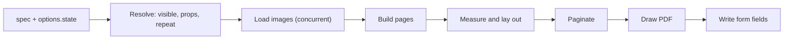

import { Aside } from "@astrojs/starlight/components";

`PDFRenderer` renders a spec built from the [PDF catalog](/json-render-swift/pdf/catalog/) to PDF. It is part of the `JSONRenderPDF` product, which depends on `JSONRenderSwiftUI` for `Spec`, `JSONValue` and the expression runtime. This page covers `PDFRenderer`, `PDFRenderer.Options` and `PDFRenderError`.

```swift
import JSONRenderPDF
import JSONRenderSwiftUI
import PDFKit // only when you use PDFDocument
```

## PDFRenderer

```swift
public struct PDFRenderer: Sendable {
    public struct Options: Sendable { ... }

    public var options: Options

    public init(options: Options = Options())

    public func render(_ spec: Spec) async throws -> Data
    public func renderResult(_ spec: Spec) async throws -> PDFRenderResult
    public func document(for spec: Spec) async throws -> PDFDocument

    public static var componentTypes: Set<String> { get }
}
```

| Member | Type | Description |
|---|---|---|
| `init(options:)` | `(Options)` | Creates a renderer. The default options use `spec.state` as is, load images with [`PDFImageLoader.default`](/json-render-swift/api/swift/pdf-image-loader/), give each image 10 seconds, apply the default [`PDFImageLimits`](/json-render-swift/api/swift/pdf-image-loader/#pdfimagelimits) and stop at 500 pages. |
| `options` | [`Options`](#options) | The options for every render. A `var`, so you can change them between renders. |
| `render(_:)` | `async throws -> Data` | Renders `spec` and returns the PDF file bytes: `renderResult(spec).data`. |
| `renderResult(_:)` | `async throws -> PDFRenderResult` | Renders `spec` and returns the bytes with the page count, the [warnings](/json-render-swift/api/swift/pdf-render-result/) and the fillable form fields. |
| `document(for:)` | `async throws -> PDFDocument` | Calls `render(_:)` and wraps the bytes in a PDFKit `PDFDocument`. |
| `componentTypes` | `Set<String>` | The 20 component types the renderer draws: the 14 document components `Document`, `Page`, `View`, `Row`, `Column`, `Heading`, `Text`, `Image`, `Link`, `Table`, `List`, `Divider`, `Spacer`, `PageNumber`, and the six [form components](/json-render-swift/pdf/forms/) `FieldSet`, `TextInput`, `Checkbox`, `RadioGroup`, `Select`, `ListBox`. |

The renderer holds no state between calls. Create one per configuration and call it as often as you like, from any task.

```swift
let renderer = PDFRenderer()
let data = try await renderer.render(spec)
```

### render(_:)

```swift
public func render(_ spec: Spec) async throws -> Data
```

Runs the [pipeline](#pipeline) and returns a complete PDF file. It is `try await renderResult(spec).data`, so it applies the same [limits](#limits) and discards the warnings and form fields. Invalid props, missing elements, unknown types, failed images and exceeded limits never throw; see [Partial and empty specs](#partial-and-empty-specs). It throws only:

- [`PDFRenderError.contextUnavailable`](#pdfrendererror), when Core Graphics can't create a PDF context;
- `CancellationError`, when the calling task is cancelled. The renderer checks between stages and before each page it paginates and draws, and stops waiting for image loads at once.

### renderResult(_:)

```swift
public func renderResult(_ spec: Spec) async throws -> PDFRenderResult
```

The full output of a render: `data`, `pageCount`, `warnings` (what was dropped, clipped, replaced by a placeholder or truncated), `formFields` (the fillable fields written to the PDF) and `isTruncated`. It throws the same errors as `render(_:)`. Use it when you show warnings, handle long documents, or read filled forms back. [PDFRenderResult](/json-render-swift/api/swift/pdf-render-result/) documents the type and every warning.

```swift
let result = try await renderer.renderResult(spec)
if result.isTruncated { print("Cut off after \(result.pageCount) pages") }
let fields = result.formFields   // pass to PDFFormReader.values(for:) later
```

### document(for:)

```swift
public func document(for spec: Spec) async throws -> PDFDocument
```

Calls `render(_:)`, then parses the bytes with `PDFDocument(data:)`. Throws what `render(_:)` throws, and `PDFRenderError.contextUnavailable` when PDFKit can't parse the result. Use it to inspect the output (page count, text, attributes) or to show it in a `PDFView`. The warnings and the form field list aren't available from it; call `renderResult(_:)` and create the `PDFDocument` from `result.data` when you need them.

### componentTypes

```swift
public static var componentTypes: Set<String> { get }
```

The component types the renderer draws. An element whose `type` isn't in this set is skipped together with all its descendants. The set matches `catalogManifest(catalog: .pdf).components` from [`JSONRenderBridge`](/json-render-swift/api/swift/json-render-bridge/).

## Options

```swift
public struct Options: Sendable {
    public var state: [String: JSONValue]
    public var imageLoader: PDFImageLoader
    public var imageTimeout: Duration
    public var imageLimits: PDFImageLimits
    public var maxPages: Int

    public init(
        state: [String: JSONValue] = [:],
        imageLoader: PDFImageLoader = .default,
        imageTimeout: Duration = .seconds(10),
        imageLimits: PDFImageLimits = PDFImageLimits(),
        maxPages: Int = 500
    )
}
```

| Member | Type | Default | Description |
|---|---|---|---|
| `state` | `[String: JSONValue]` | `[:]` | Top-level state keys that replace the same keys of `spec.state`. |
| `imageLoader` | [`PDFImageLoader`](/json-render-swift/api/swift/pdf-image-loader/) | `.default` | Loads the bytes of every `Image` `src`. Use `.placeholders` for offline, deterministic output. |
| `imageTimeout` | `Duration` | `.seconds(10)` | The time each image load may take. A slower image is drawn as a placeholder. |
| `imageLimits` | [`PDFImageLimits`](/json-render-swift/api/swift/pdf-image-loader/#pdfimagelimits) | `PDFImageLimits()` | Byte, pixel, concurrency and downsampling budgets for images. An image over a budget is drawn as a placeholder. |
| `maxPages` | `Int` | `500` | The most physical pages a render produces. Longer documents are cut off with a `pageLimitReached` warning. Values below 1 count as 1. |

### state

The renderer starts from `spec.state` (or `{}` when it is missing or not an object) and shallowly overrides its top-level keys with the ones in `state`: a key in `state` replaces the whole value under that key, and nested objects are not merged.

```swift
// spec.state: { "customer": { "name": "Jane", "email": "jane@example.com" }, "items": [...] }
let renderer = PDFRenderer(options: .init(state: [
    "customer": ["name": "Ada"], // replaces /customer entirely: /customer/email is now absent
]))
```

To change one nested field, pass the whole object for its top-level key.

### imageLoader and imageTimeout

Every image is loaded before layout, at most `imageLimits.maxConcurrentLoads` at a time, and each load gets `imageTimeout`. A thrown error, bytes ImageIO can't decode, a timeout or an exceeded budget draws a neutral placeholder box instead and adds an `imageUnavailable` warning; the render never fails because of an image. [PDFImageLoader](/json-render-swift/api/swift/pdf-image-loader/) covers the built-in loaders, the budgets, the failure policy and writing your own.

### maxPages

Pagination stops once `maxPages` pages exist. The PDF keeps those pages, `renderResult(_:)` reports `pageLimitReached(limit:)` and `isTruncated`, and form fields on the cut pages aren't written. `render(_:)` returns the truncated PDF without telling you, so use `renderResult(_:)` when documents can be long.

```swift
let renderer = PDFRenderer(options: .init(maxPages: 20))
let result = try await renderer.renderResult(spec)
result.isTruncated   // true when the spec needed more than 20 pages
```

## Limits

A spec can come from a model or a server, so every render is bounded. Hitting a limit never throws: the renderer drops or clips the excess and reports it in [`PDFRenderResult.warnings`](/json-render-swift/api/swift/pdf-render-result/).

| Limit | Value | When exceeded |
|---|---|---|
| Nesting depth | 32 levels | Deeper elements are dropped with their subtrees: `nestingTooDeep(limit: 32)`. |
| Elements | 20,000, counted after `repeat` expansion | Later elements are dropped: `tooManyElements(limit: 20000)`. |
| Pages | `Options.maxPages` (500) | The document is cut off: `pageLimitReached(limit:)`. |
| Content taller than a page | One page | An unsplittable box is clipped at the page bottom; a page-number footer is limited to a quarter of the page: `contentClipped`. |
| Image time, bytes, pixels | `imageTimeout` and `imageLimits` | The image draws as a placeholder: `imageUnavailable(source:)`. |
| Numeric props | Per prop | Clamped to a finite range: lengths to 0-10,000 pt, font sizes to 1-500 pt, page margins to a third of the page. No warning. |

## PDFRenderError

```swift
public enum PDFRenderError: Error, Sendable {
    case contextUnavailable
}
```

| Case | Thrown when |
|---|---|
| `contextUnavailable` | Core Graphics can't create the PDF data consumer or context, or (from `document(for:)` only) `PDFDocument(data:)` returns `nil` for the rendered bytes. |

## Pipeline

A render runs these steps in order:



1. **State.** `spec.state` with the top-level keys of `options.state` replaced.
2. **Resolve.** A walk from `spec.root`. For each element: skip it when its key is missing or already on the path from the root (a cycle), evaluate `visible` and skip it when hidden, skip it when its type isn't in `componentTypes`, then resolve its props. An element with `repeat` renders its children once per array item, each in a [`RepeatScope`](/json-render-swift/api/swift/repeat-scope/); other elements render their children in the current scope. A skipped element drops its whole subtree.
3. **Load images.** The `src` of every resolved `Image` (hidden images are not loaded, and each distinct `src` loads once) through `options.imageLoader`, concurrently, each limited by `options.imageTimeout` and checked against `options.imageLimits`.
4. **Build pages.** Each `Page` becomes a page model with its size, orientation, margins and background. Each component maps to layout boxes with its default styles.
5. **Measure and lay out.** Core Text measures text with Helvetica metrics, English hyphenation and paragraph-level line breaking, in top-left page coordinates (points).
6. **Paginate.** Each page's content splits into physical pages, up to `options.maxPages`. Pagination finishes before drawing, so `PageNumber` knows the total page count.
7. **Draw.** A Core Graphics PDF context draws every physical page, then adds link annotations and document metadata. Form components are drawn as labels and empty field frames.
8. **Write form fields.** When the spec has [form components](/json-render-swift/pdf/forms/), the renderer appends an AcroForm to the drawn PDF as an incremental update: the fields, their widgets on the pages where the frames were drawn, and their appearances. A document without fields gets no AcroForm.

[Layout and pagination](/json-render-swift/pdf/layout/) describes steps 4 to 6 from the spec author's side.

## Partial and empty specs

The renderer accepts any `Spec`, including a half-streamed one, and always produces at least one page:

| Input | Output |
|---|---|
| No `root`, or `root` names no element (for example `Spec.empty`) | One blank A4 page. |
| Root is a `Document` | One page model per `Page` child. Consecutive children that aren't `Page`s are placed on a default page (A4, portrait, 40 pt margins). A `Document` with no renderable children gives one blank A4 page. |
| Root is a `Page` | That page. |
| Root is any other component | The element on a default page. |
| Root type isn't a catalog component, or the root is hidden | One blank A4 page. |
| A child key names no element | The child is skipped. |
| A `repeat` whose `statePath` reads no array | The element renders with no children. |
| A `repeat` with an `{ "$item": ... }` `statePath` outside any repeat | The element and its subtree are skipped. |
| A numeric prop that isn't a number, such as `"fontSize": "big"` | The component's default for that prop. String props convert other values like JavaScript `String(value)`, so `"text": 42` draws `42`. |

Each re-render while a spec streams starts from scratch, so a page may reflow as later elements arrive.

## Metadata

When the root is a `Document`, its `title`, `author` and `subject` props become the PDF's Title, Author and Subject. A `null` or missing prop leaves that entry out; any other non-string value is converted like JavaScript `String(value)`. Every PDF gets the Creator `json-render (JSONRenderPDF)`. Props of a `Document` that isn't the root are ignored.

```swift
let document = try await renderer.document(for: spec)
let attributes = document.documentAttributes ?? [:]
attributes[PDFDocumentAttribute.titleAttribute] as? String   // "Invoice #1042"
attributes[PDFDocumentAttribute.creatorAttribute] as? String // "json-render (JSONRenderPDF)"
```

## Links

A [`Link`](/json-render-swift/pdf/catalog/#link) whose `href`, trimmed of spaces and tabs, parses as a `URL` gets one URL annotation per drawn line of its text, covering that line. PDF viewers open the URL when the reader taps or clicks the text. A `Link` with an `href` that doesn't parse is drawn the same way (underlined) without an annotation. No other component creates annotations.

```swift
let urls = document.page(at: 0)?.annotations.compactMap(\.url) // [https://example.com]
```

## Threading

`PDFRenderer` and `Options` are `Sendable` value types, so you can create a renderer on one actor and use it on another.

- `render(_:)` and `document(for:)` are nonisolated `async` functions, so they run on the global concurrent executor, off the main actor even when you call them from it.
- Image loads run as child tasks of the render, one per distinct `src`. Your loader closure is `@Sendable` and may run on any thread.
- Resolving, layout, pagination and drawing run synchronously in the calling task after the images arrive. They create their own Core Text and Core Graphics objects and share nothing with other renders, so several renders can run in parallel.
- `document(for:)` creates the `PDFDocument` in the same task. `PDFDocument` isn't `Sendable`; use it from the context that received it.

## Examples

### Write a PDF file

```swift title="ExportInvoice.swift"
import Foundation
import JSONRenderPDF
import JSONRenderSwiftUI

func exportInvoice(from specURL: URL, to outputURL: URL) async throws {
    let spec = try Spec(jsonData: Data(contentsOf: specURL))
    let renderer = PDFRenderer(options: .init(state: ["customer": ["name": "Ada Lovelace"]]))
    let data = try await renderer.render(spec)
    try data.write(to: outputURL, options: .atomic)
}
```

### Inspect the output

```swift title="InvoiceTests.swift"
import JSONRenderPDF
import JSONRenderSwiftUI
import PDFKit
import Testing

@Test func invoiceRendersOnePage() async throws {
    let spec = try Spec(jsonString: invoiceJSON)
    let renderer = PDFRenderer(options: .init(imageLoader: .placeholders))
    let document = try await renderer.document(for: spec)

    #expect(document.pageCount == 1)
    #expect(document.string?.contains("Invoice #1042") == true)
    #expect(document.page(at: 0)?.string?.contains("1 / 1") == true)
}
```

`.placeholders` keeps tests offline and their output identical from run to run.

<Aside>
To show the PDF in SwiftUI, use [`JSONRenderPDFView`](/json-render-swift/api/swift/json-render-pdf-view/), which renders in a task and keeps the previous document on screen while a new one renders.
</Aside>

## Next

- [PDFRenderResult](/json-render-swift/api/swift/pdf-render-result/): the result of `renderResult(_:)` and every warning.
- [JSONRenderPDFView](/json-render-swift/api/swift/json-render-pdf-view/): the SwiftUI preview.
- [Fillable Forms](/json-render-swift/pdf/forms/): the form components and reading filled PDFs back.
- [PDFImageLoader](/json-render-swift/api/swift/pdf-image-loader/): loading, caching and failure handling for images.
- [RepeatScope and RepeatConfig](/json-render-swift/api/swift/repeat-scope/): how `repeat` and `$item` resolve.
- [PDF quick start](/json-render-swift/pdf/quick-start/): generate and render a first document.
