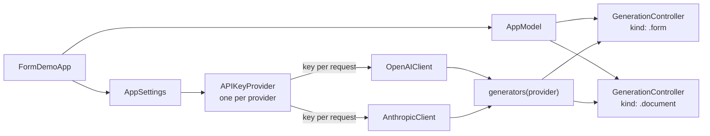
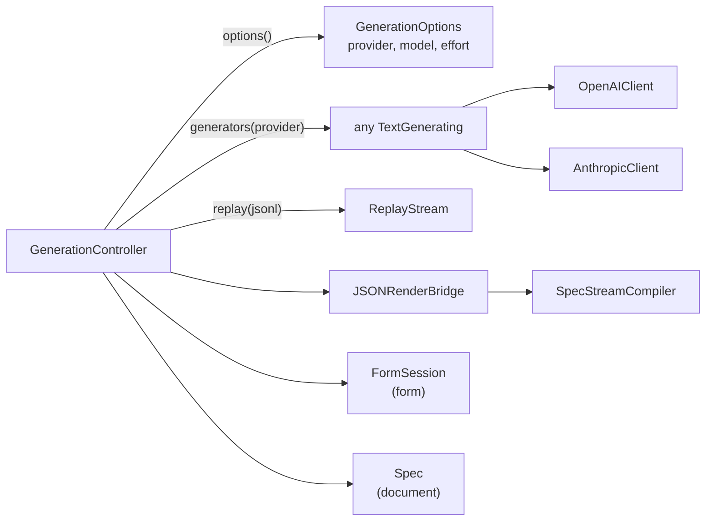
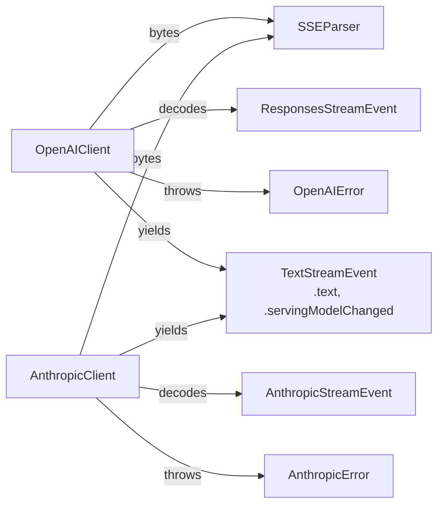
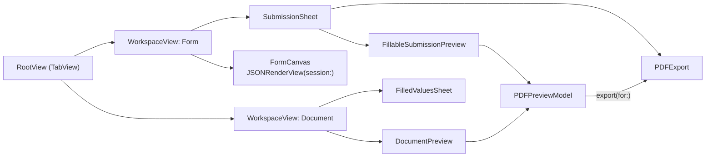

import { Aside, FileTree } from "@astrojs/starlight/components";
import Screenshot from "../../../components/Screenshot.astro";
import Screenshots from "../../../components/Screenshots.astro";

FormDemo is an iOS 26 SwiftUI app in `ios/` with two modes. **Form** asks an AI model (OpenAI or Claude, chosen in Settings) for a form, streams the model's JSONL patches through the SDK's stream compiler and renders the form with native controls while it arrives. **Document** does the same with the PDF catalog and shows a live, fillable PDF preview that you can share as a file. In both modes a follow-up prompt edits the spec that is showing, and offline examples and recorded streams work without an API key.

This page describes the screen and the code. [Life of a Prompt](/demo/prompt-lifecycle/) follows one prompt through the pipeline, and [Running the Demo](/demo/running/) covers building, API keys, settings and launch arguments.

<Screenshots>
  <Screenshot name="01-empty.png" alt="The Form tab's empty screen: 'Describe a form', six suggestion buttons, Examples and Replay stream under 'No API key? Try offline', the prompt bar and the Form / Document tab bar" caption="Form mode at first launch" width={260} />
  <Screenshot name="document-empty.png" alt="The Document tab's empty screen: 'Describe a document', document suggestions, Examples and Replay stream, and the prompt bar reading 'Describe a document…'" caption="Document mode at first launch" width={260} />
</Screenshots>

## Two modes

`RootView` is a `TabView` with one tab per `GenerationKind`: **Form** (`list.bullet.rectangle`) and **Document** (`doc.richtext`). Each tab is a full `WorkspaceView` with its own `GenerationController`, so the modes are separate workspaces. Switching tabs keeps the other mode's spec, raw stream, banners and form input.

`AppModel` holds the selected mode and the two controllers. Both controllers get the same two clients and read the same settings, but each creates its own `JSONRenderBridge` on first use and caches its own system prompt.

`GenerationKind` supplies everything that differs between the modes:

| | Form | Document |
|---|---|---|
| Bridge catalog (`catalog`) | `.swiftui` | `.pdf` |
| Custom prompt rules (`customRules`) | One rule announcing the `log` action | None |
| Host actions for validation (`hostActions`) | `["log"]` | None |
| Offline examples | Registration, Event RSVP, Feedback Survey, Shipping Address | Invoice, Quarterly Report, Resume, Business Letter, Bank Statement, Rental Application (fillable) |
| Recorded streams (`replays`) | Replay registration (`registration.jsonl`) | Replay bank statement (`statement.jsonl`), Replay fillable application (`application-form.jsonl`) |
| Spec held as | A `FormSession` (spec plus live state) | A bare `Spec` |
| UI tab | `JSONRenderView` | `DocumentPreview`, a PDFKit `PDFView` you can fill in |
| Edit prompts send | The current spec and the live state | The current spec (its `state` is part of the spec) |

The first entry of `replays` is the mode's default stream, which **Replay stream** on the empty screen and `-replay` without an ID play.

## Providers and models

Settings → **Provider** chooses **OpenAI** or **Claude** for both modes. Until you pick one, the app uses OpenAI, unless only a Claude key is configured (no OpenAI key in the Keychain or the environment, and a Claude key in either). The choice, the model and the effort are read once when a generation starts, so changing them mid-stream doesn't affect the running request.

| | OpenAI | Claude |
|---|---|---|
| Endpoint | `POST https://api.openai.com/v1/responses` | `POST https://api.anthropic.com/v1/messages` |
| Client | `OpenAIClient` | `AnthropicClient` (URLSession and the app's own SSE parser; no SDK) |
| Models in Settings | `gpt-6-astra`, `gpt-6.1-sol`, `gpt-6-luna` (default), Custom… | Claude Fable 5 (`claude-fable-5`), Claude Opus 5.5 (`claude-opus-5-5`), Claude Sonnet 5.5 (`claude-sonnet-5-5`, default), Claude Haiku 5.5 (`claude-haiku-5-5`), Custom… |
| Effort choices | Model default, Low, Medium, High | Model default, Low, Medium, High, Extra high (`xhigh`), Max |
| Effort sent as | `reasoning.effort` | `output_config.effort` |
| API key | Keychain item `openai-api-key`, else `OPENAI_API_KEY` | Keychain item `anthropic-api-key`, else `ANTHROPIC_API_KEY` |

- **Custom model IDs.** **Custom…** shows a **Model ID** field for any ID the API accepts. A blank field uses the provider's default model.
- **Per provider.** The model, the effort and the custom ID are saved separately for each provider (`UserDefaults` keys `openai.model`, `openai.effort`, `anthropic.model`, `anthropic.effort`), so switching providers and back restores each one's settings. Each provider also has its own Keychain item.
- **Model default** sends no effort parameter. A saved effort the provider doesn't offer (for example `xhigh` for OpenAI) resets to Model default at launch and when the model changes.
- **Refusal fallback.** Requests to `claude-opus-5-5` and `claude-sonnet-5-5` also send `fallbacks: "default"` with the `anthropic-beta: server-side-fallback-2026-07-01` header. When the API then switches the response to a fallback model, it sends a `fallback` content block, and the fallback model's text continues the same output. The app keeps everything that has arrived, including a half-received JSONL line, and shows a "Continued on Claude Sonnet 5.5" toast (the model's display name, or its ID for unlisted models). Other Claude models send neither field. [Life of a Prompt](/demo/prompt-lifecycle/#claude-refusal-fallback) shows the sequence.

[Running the Demo](/demo/running/#provider-model-and-effort) shows the Settings screen for both providers.

## The screen

### Empty state

Before a spec exists, `EmptyStateView` shows a title ("Describe a form" or "Describe a document"), a one-line explanation, suggestion buttons and two offline buttons under "No API key? Try offline". A suggestion sends its text as a prompt. **Examples** opens a menu of the mode's bundled specs ([forms](/examples/), [documents](/pdf/examples/)), and **Replay stream** plays the mode's default recorded stream.

| Mode | Suggestions |
|---|---|
| Form | Sign-up form with password confirmation, Event RSVP, Customer feedback survey, Shipping address, Job application, Restaurant reservation |
| Document | Invoice for a web design project, Fillable rental application form, One-page resume for an iOS engineer, Quarterly sales report, Cover letter, Meeting minutes, Rental agreement summary |

Once a stream has started but no patch has set a root yet, the empty state is replaced by a "Waiting for the first patch…" spinner.

### Prompt bar

`PromptBar` floats at the bottom in a Liquid Glass shape. Its placeholder is "Describe a form…" or "Describe a document…" when the workspace is empty, and "Ask for a change…" when a spec is showing, because the next prompt then edits it. The field grows to five lines; pressing Return sends instead of inserting a newline. Send is disabled while the text is blank.

While a stream runs, the send button turns into a red **Stop** button, and a capsule above the bar shows "Generating" or "Replaying stream" with the running patch count.

### UI, JSON and JSONL tabs

When a spec with a root exists, a segmented control under the title switches between three views. Sending a prompt, loading an example or starting a replay switches back to **UI**.

| Tab | Form | Document |
|---|---|---|
| UI | The form, rendered by `JSONRenderView` with the app's action handlers and button override. | The fillable PDF preview. |
| JSON | Two cards: **Spec**, the current spec pretty-printed, and **State · live**, the state store, which updates as you type. | One card: **Spec**. |
| JSONL | The raw text of the latest stream, titled "JSONL stream · N patches". | Same. |

Each card has a copy button (disabled when the card is empty) and a "Copied" toast confirms the copy. Examples load a finished spec, so after an example the JSONL card reads "Examples load the finished spec directly, so there is no stream. Generate a form or use Replay stream to see one." (with "document" in Document mode).

<Screenshots>
  <Screenshot name="02-registration.png" alt="The Create Account form with the UI/JSON/JSONL tabs, the prompt bar reading 'Ask for a change…' and the tab bar" caption="Form UI tab: the title comes from the Form element" width={260} />
  <Screenshot name="05-json.png" alt="The JSON tab for the Summer Party RSVP form, showing the Spec card with the arrival DatePicker element" caption="Form JSON tab: the Spec card (the live state card follows below it)" width={260} />
  <Screenshot name="07-jsonl.png" alt="The JSONL tab with the heading 'JSONL stream · 23 patches' and raw patch lines" caption="JSONL tab after Replay stream: the raw model-style output" width={260} />
</Screenshots>

### Title

In Form mode the navigation title is the root element's `title` prop, shown large, or "Form Demo" when the root has no string title. In Document mode it is the resolved `Document.title` (a `$template` title is resolved against the spec's `state`), or "Document", shown inline. Both are empty while no spec exists.

### PDF preview

`DocumentPreview` shows the document of a `PDFPreviewModel` in `FillablePDFView`, a PDFKit `PDFView` (auto-scaled, single page continuous, vertical). The model, not the view, owns the `PDFDocument`, and the workspace keeps one model for its lifetime, so edits to form fields survive switching to the JSON tab, to the other mode and back.

- **When it renders.** `PDFPreviewModel.show(_:revision:isStreaming:)` renders with `PDFRenderer(options:).renderResult(_:)` only when the spec or the controller's `revision` differs from what it shows. Showing the same spec and revision again keeps the document and its edits.
- **Revisions.** The controller increments `revision` whenever it replaces the spec rather than updating it: loading an example, Clear, and a new (non-edit) generation or replay. A new revision drops the cached document even if the new spec is equal to the old one. **Clear** and loading an example also call `reset()` on the model.
- **Throttle.** While a stream runs, a render waits until 0.5 seconds have passed since the last one. The view's `.task(id:)` is keyed by spec, revision and streaming state, so a newer spec cancels the waiting task and takes its place, and the final spec renders when the stream ends. Outside a stream, specs render at once.
- **Stale renders.** Every call to `show` increments a request counter, and a render publishes only if it is still the latest request. A slow render (for example, one waiting on an image) never replaces a newer document or the user's edits to it.
- **Errors.** If a render fails, an orange capsule at the top of the preview shows the error, and the last good document stays on screen. The capsule disappears after the next successful render.
- **Page position.** When the document changes, the view keeps the current page index, so a re-render during a stream doesn't jump back to page 1.

<Screenshots>
  <Screenshot name="document-invoice.png" alt="Document mode showing the Invoice #1042 example as a PDF page, with the Share and More buttons, the UI/JSON/JSONL tabs and 'Ask for a change…'" caption="Document UI tab: the invoice example. The title is the Document element's title" width={260} />
  <Screenshot name="document-streaming.png" alt="A partly streamed bank statement: the bank header, customer line, notice and Summary table, with a 'Replaying stream, 31 patches' capsule and a red Stop button" caption="Replay stream in Document mode after 31 patches. Share PDF is hidden while the stream runs" width={260} />
  <Screenshot name="document-json.png" alt="The JSON tab for the bank statement, showing a single Spec card with the account Column and a Text element with a $template" caption="Document JSON tab: only the Spec card" width={260} />
</Screenshots>

### Fillable documents

A document that uses the PDF form components ([PDF forms](/pdf/forms/)) renders with interactive widgets. Tap a field in the preview to type, check or choose. The **Rental Application (fillable)** example and the **Replay fillable application** stream show one, and "Fillable rental application form" is a suggestion.

**Read filled values** (toolbar, clipboard icon) appears when the document has fields, no stream is running and the preview shows the current spec and revision. It reads the document as it is now, including your edits:

1. `PDFPreviewModel.filledValues()` takes the shown document's `dataRepresentation()`, opens it with `PDFFormReader(data:)` and reads `values(for:)` the render's form fields.
2. `PDFFormReader.stateUpdates(_:fields:)` turns every value whose field is bound to state (`$state`, `$bindState` or `$bindItem`) into a JSON Pointer and value.
3. Filled fields without a binding (non-empty text, a checked box, a selection) are collected as unbound.

The **Filled values** sheet (medium and large detents) shows "Read from the PDF as it is now, including your edits: N fields. M map to the document's state.", the values as JSON keyed by fully qualified field name (for example `applicant.address.city`), and, when there are any, "Not bound to state, so not applied: …". **Copy** copies the JSON.

**Apply to state** (disabled when no value is bound) calls `controller.applyState(_:)`. It creates the spec's `state` object if there is none, writes each value at `/state` plus its pointer, and stores the spec in place without a new revision. The changed spec re-renders, so the document now shows the values from its state, and a toast reads "Applied N values to state". Unbound fields aren't written anywhere; their edits are lost on that re-render.

<Screenshots>
  <Screenshot name="document-fillable.png" alt="The Rental Application document in the UI tab, with the Read filled values, Share and More buttons, and filled-in text fields, a State dropdown, radio buttons and a list box on page 1" caption="The fillable application example. The toolbar shows Read filled values next to Share PDF" width={260} />
  <Screenshot name="document-filled-values.png" alt="The Filled values sheet over the application: 'Read from the PDF as it is now, including your edits: 30 fields. 20 map to the document's state.', JSON with applicant.firstName Alex, and an Apply to state button" caption="Read filled values after editing the first and last name: 30 fields, 20 bound to state" width={260} />
</Screenshots>

### Share PDF

In Document mode, when a spec exists and no stream is running, the toolbar shows **Share PDF**. It is a `ShareLink` for a `PDFExport`, a `Transferable` value with a PDF `FileRepresentation`. `PDFPreviewModel.export(for:revision:)` decides what the file contains:

- **Fillable and current.** When the shown document has form fields and is the current spec and revision, the export holds a `LivePDFDocument`, and the file is a snapshot of the previewed `PDFDocument` (`dataRepresentation()`, read on the main actor). It contains everything you filled in, including fields that aren't bound to state.
- **Otherwise.** Nothing renders until the share sheet asks for the file; then `PDFExport.render()` runs `PDFRenderer().render(spec)`.

Either way, the bytes are written to a new folder in the temporary directory. The file name is the resolved `Document.title` with `/ \ : ? % * | " < >`, newlines and control characters replaced by `-`, plus an optional suffix, cut to 120 characters, plus `.pdf`. A spec without a title gives `Document.pdf`.

| `Document.title` | File name |
|---|---|
| `Invoice #1042` | `Invoice #1042.pdf` |
| `Q3: A/B results` | `Q3- A-B results.pdf` |
| `{ "$template": "Statement - ${/period/label}" }` (the statement example) | `Statement - March 1 - March 31, 2025.pdf` |
| none | `Document.pdf` |

### Toolbar

| Control | Contents |
|---|---|
| Examples (top left) | **Offline examples**: the mode's bundled specs. **Recorded streams**: the mode's replays. Disabled while a stream runs. |
| Read filled values (top right, Document mode) | Opens the Filled values sheet. Only for a fillable document that is current and not streaming. |
| Share PDF (top right, Document mode) | Shares the current document as a PDF file. Hidden while streaming or without a spec. |
| More, ⋯ (top right) | **Copy JSON** (the spec; disabled without one), **Clear**, **Settings**. |

**Clear** is enabled when a spec exists or a stream is running. It asks "Clear the current form?" (or "document?") first, then stops any run, empties the workspace and the prompt field, drops the cached PDF and its edits, and returns to the UI tab.

### Banners and toasts

Banners appear above the prompt bar and close with ×. An error banner takes precedence over a validation banner.

- **Error**: titled "Something went wrong", with the message from the failed run: a missing key (naming the provider and where to set it), an HTTP status with the API's message, a stream or decode failure, a refusal, a reply with no patches, or a cut-off response. When the currently selected provider has no key, it has a **Settings** button. [Life of a Prompt](/demo/prompt-lifecycle/#errors-and-refusals) lists every message for both providers.
- **Validation**: after each completed generation, replay or example load, the spec is validated against the mode's catalog. The banner reads, for example, "Spec validation: 1 error, 2 warnings" (red icon when there are errors, orange for warnings only), and **Show** lists each issue's message and path. If `autoFixSpec` repaired the spec, it adds "The spec was repaired with autoFixSpec."; if the repair left no issues, the title is "Spec fixed automatically".

Toasts appear at the top in a glass capsule: "Copied" and "Applied N values to state" (1.5 seconds), the `log` action's message (2 seconds), and "Continued on `<model>`" after a Claude refusal fallback (4 seconds).

### Submission sheet

In Form mode, when the form's `submit` action passes validation, the app opens a **Submitted** sheet (medium and large detents) with three tabs:

- **Data**: "All checks passed. This is what the submit action sent to the app." and the submitted data as pretty-printed JSON. When the sheet was opened with a `-submit` launch argument, the line reads "Current form data. The submit action and its validation did not run." instead.
- **PDF**: a summary document of the submission, previewed with `JSONRenderPDFView`.
- **Fillable PDF**: the form as a fillable PDF, seeded with the submitted values, in a `FillablePDFView` you can edit. The sheet owns its own `PDFPreviewModel`, so edits survive switching tabs.

The toolbar has **Copy** (the JSON), an **Export** menu and **Done**. **Export as PDF** shares the summary (for example `Summer Party RSVP.pdf`). **Export as fillable PDF** shares the fillable form as `<title> (fillable).pdf`: a snapshot of the previewed document with your edits when the Fillable PDF tab has rendered it, otherwise a fresh render of the mapped spec.

<Screenshots>
  <Screenshot name="08-submitted.png" alt="The Submitted sheet over the Summer Party RSVP form on the Data tab, saying the submit action did not run, and the form data as JSON" caption="Data tab. This capture used -submit, which opens the sheet without running the action" width={260} />
  <Screenshot name="form-export-pdf.png" alt="The Submitted sheet on the PDF tab: a summary page titled Summer Party RSVP with the subtitle, the submission date, a Field/Value table and 'Page 1 of 1'" caption="PDF tab: the summary document that Export as PDF shares" width={260} />
  <Screenshot name="form-export-fillable.png" alt="The Submitted sheet on the Fillable PDF tab: Summer Party RSVP as a PDF form with Name and Email text fields, a Yes/Maybe/No radio group, Guests, Arrival Time (YYYY-MM-DD HH:MM) and a Meal dropdown" caption="Fillable PDF tab: the form mapped to PDF form fields, seeded with the submitted values" width={260} />
</Screenshots>

#### Which values are submitted

Both PDFs read values from the submitted `data`, resolved exactly against the state pointer it came from. That pointer is the `$state` (or `$bindState`) path of a `submit` binding's `data` param, for example `/form` for `{"data": {"$state": "/form"}}`. With several submit bindings, it is the one whose current value equals the data; with one, that one. A field outside that subtree wasn't submitted: the summary leaves it out, and the fillable export uses its live value. Live state also drives visibility, labels and picker options in both.

#### The summary PDF

`SubmissionSummary.spec(form:data:dataRoot:state:submittedAt:)` builds the summary with the PDF catalog's components:

- A `Document` titled with the form's resolved `title` (or "Form Submission"), author "Form Demo", and one A4 `Page` with 50 pt margins.
- A `Heading` (h1) with the title, the form's `subtitle` as `Text` when there is one, and "Submitted" with the date (long date, short time).
- A `Divider`, then a striped `Table` with **Field** (40%) and **Value** (60%) columns, and a `PageNumber` with the format `Page {pageNumber} of {totalPages}`.

The table has one row per visible submitted field, in document order. The walk starts at the root and skips any element whose `visible` condition is false, together with its children. An element produces a row when it is a `TextField`, `SecureField`, `Stepper` or `Slider` bound on `value`, a `Toggle` bound on `isOn`, or a `Picker` or `DatePicker` bound on `selection`, and the submitted data has a value for it. The label is the resolved `label` prop, or the element key. A `$template` label that ends with a placeholder, such as `"Guests: ${/form/guests}"`, drops that placeholder and the separator before it.

| Value | Shown as |
|---|---|
| `null` or an empty string | `—` |
| `SecureField` text | `••••••••` |
| `Toggle` | Yes / No |
| `Picker` selection | The matching option's `label`, else the raw value |
| `DatePicker`, `YYYY-MM-DD` | A long date in the device's locale (the date itself is read as UTC) |
| `DatePicker`, full ISO 8601 date-time | Date and short time in the device's time zone |
| `DatePicker`, anything else | The raw string |
| Other numbers, booleans, arrays, objects | Their JSON text |

#### The fillable PDF

`FillablePDFMapper.spec(form:data:dataRoot:state:)` maps the SwiftUI spec to a PDF form spec. The page has the title as an h1 `Heading`, the subtitle, a `Divider`, the mapped fields and a `PageNumber`, on an A4 portrait `Page`; the `Document` has the subject "Fillable form".

| SwiftUI | PDF |
|---|---|
| `TextField` / multiline | `TextInput` / `TextInput` with `multiline` and `lines` (the `lineLimit`, default 3, clamped to 2...8) |
| `SecureField` | `TextInput` with `password`, never seeded |
| `Toggle` | `Checkbox`; required when it has a `required` check or must match `true` |
| `Picker` segmented / inline / wheel | `RadioGroup`, vertical |
| `Picker` menu / navigationLink / default | `Select` |
| `DatePicker` | `TextInput` with a format hint in the label (`YYYY-MM-DD`, `HH:MM`, `YYYY-MM-DD HH:MM`) |
| `Stepper`, `Slider` | `TextInput`, right-aligned, with a `min–max` placeholder when both bounds are set |
| `Section` | `FieldSet` (named after the section key) with a `Heading` (h3) and the footer as `Text` |
| `VStack`, `HStack` | `Column` |
| `Text`, `LabeledContent` | `Text` |

- Hidden elements and buttons are omitted.
- `required` and `maxLength` checks carry over.
- Field names come from the bound pointer's last segment, restricted to letters, digits, `_` and `-`, and made unique with a number suffix (`email`, `email2`). Inside a `FieldSet`, the PDF field is qualified with the section name, for example `guest.name`.
- Values are seeded from the submitted data first, then from live state. A picker value is used only when it matches one of its options.
- Every element carries all of its catalog props, with `null` for unset ones, because the PDF catalog's props are required but nullable.
- The mapped fields carry literal values, not `$bindState` bindings, so the fillable export has no state to apply values to.

### Settings

**⋯ → Settings** holds the provider, the selected provider's API key (saved to the Keychain), its model and its effort, plus the endpoint. [Running the Demo](/demo/running/#api-keys) describes each setting.

## Architecture

App wiring: one `AppSettings`, one client per provider, and one controller per mode. Each controller picks the client for the provider selected when a run starts.



One controller: the options snapshot decides the text source, and the bridge compiles its output into the mode's spec.



The clients: both parse server-sent events with the same parser and yield `TextStreamEvent` values.



Views: each tab is a workspace that renders its controller's output. The two PDF previews each own a `PDFPreviewModel`.



`FormDemoApp` puts `AppSettings` and `AppModel` into the environment. `RootView` gives each `WorkspaceView` its mode's controller through `.environment(model.controller(for: kind))`, so every view below a workspace sees only that mode's controller.

<FileTree>
- ios/
  - project.yml XcodeGen spec: app, tests, scheme with OPENAI_API_KEY and ANTHROPIC_API_KEY
  - FormDemo.xcconfig empty key defaults + #include? "Secrets.xcconfig"
  - Secrets.xcconfig your keys, git-ignored (you create it)
  - FormDemo/
    - App/
      - FormDemoApp.swift wires AppSettings + both clients into AppModel
      - LaunchOptions.swift -mode, -example, -pdf-example, -replay, -tab, …
    - Models/
      - AppModel.swift selected mode + one GenerationController per mode
      - GenerationKind.swift form | document: catalog, rules, host actions, examples, copy
      - GenerationController.swift the pipeline: prompt → stream → compiler → spec → validate
      - SubmissionSummary.swift form spec + submitted data → summary PDF spec
      - FillablePDFMapper.swift form spec + submitted data → fillable PDF form spec
      - PDFPreviewModel.swift the previewed PDFDocument, renders, reads filled values
      - ExampleSpec.swift bundled fixture specs and replay streams
      - ViewMode.swift UI / JSON / JSONL
    - Services/
      - TextGenerating.swift protocol, GenerationRequest, TextStreamEvent
      - Provider.swift openai | anthropic: models, defaults, efforts, key names
      - OpenAIClient.swift Responses API request, SSE → text deltas
      - ResponsesStreamEvent.swift the OpenAI events the app acts on
      - OpenAIError.swift OpenAI errors and messages
      - AnthropicClient.swift Messages API request, SSE → text and fallback notes
      - AnthropicStreamEvent.swift the Claude events the app acts on
      - AnthropicError.swift Claude HTTP, stream, refusal and cut-off errors
      - SSEParser.swift byte-level text/event-stream parser
      - PDFExport.swift Transferable PDF file named after Document.title
      - KeychainStore.swift one Keychain item
      - AppSettings.swift provider, per-provider model, effort and key
      - ReplayStream.swift deterministic chunks for the offline replay
    - Views/
      - RootView.swift TabView: Form | Document
      - WorkspaceView.swift one mode's screen, toolbar, tabs, FormCanvas
      - DocumentPreview.swift fillable preview, also FillablePDFView
      - FilledValuesSheet.swift values read from the PDF, Apply to state
      - PromptBar.swift also StreamingStatus
      - Banners.swift MessageBanner, IssuesBanner
      - EmptyStateView.swift also FlowLayout
      - CodeView.swift
      - SettingsView.swift
      - SubmissionSheet.swift Data, PDF and Fillable PDF tabs, Export menu
      - ProminentFormButton.swift custom Button renderer
    - Resources/
      - Assets.xcassets
  - FormDemoTests/ Swift Testing suites
</FileTree>

The app has no copy of the fixtures: `project.yml` adds `../fixtures/specs` (four form specs and `registration.jsonl`) and `../fixtures/pdf` (six document specs, `statement.jsonl` and `application-form.jsonl`, excluding `reference/`) as resources, so they are bundled straight from the repository.

### Types

| Type | File | Role |
|---|---|---|
| `FormDemoApp` | App/FormDemoApp.swift | Creates `AppSettings`, an `OpenAIClient` and an `AnthropicClient` that each read their key through the matching `APIKeyProvider`, and an `AppModel` whose `generators` closure maps a `Provider` to its client and whose options closure returns `settings.generationOptions`. |
| `LaunchOptions` | App/LaunchOptions.swift | Parses launch arguments for screenshots and demos. See [Running the Demo](/demo/running/#launch-arguments). |
| `AppModel` | Models/AppModel.swift | `@MainActor @Observable`. The selected `mode` and two controllers, `forms` and `documents`; `controller(for:)` picks one. A convenience initializer takes one `generator` for every provider (tests). |
| `GenerationKind` | Models/GenerationKind.swift | `form` or `document`. Catalog, custom rules, host actions, examples, replays, suggestions and the empty-state and placeholder text. |
| `GenerationController` | Models/GenerationController.swift | `@MainActor @Observable`, one per mode. Owns the spec (a `FormSession` for forms, a `Spec` for documents), the `revision`, the raw JSONL, the patch count, the activity (`idle`, `generating`, `replaying`), the banners, the submission and the toast. Runs generations and replays, loads examples, stops, clears and applies filled values. |
| `GenerationOptions` | Models/GenerationController.swift | `provider` (default `.openAI`), `model` and `reasoningEffort`, read once when a generation starts. |
| `Toast` | Models/GenerationController.swift | A short note: message and SF Symbol. |
| `Submission` | Models/GenerationController.swift | The data the `submit` action received, whether validation ran, the summary PDF spec and the fillable PDF spec. |
| `SubmissionSummary` | Models/SubmissionSummary.swift | Builds the summary PDF spec and its rows; finds the submitted data's root (`dataRoot(in:data:state:)`). |
| `FillablePDFMapper` | Models/FillablePDFMapper.swift | Maps a form spec to a fillable PDF form spec seeded with the submitted values. |
| `PDFPreviewModel` | Models/PDFPreviewModel.swift | `@MainActor @Observable`. Holds the previewed `PDFDocument`, its form fields and the spec and revision it shows; renders on change with the streaming throttle; `filledValues()`, `export(for:revision:fileSuffix:)`, `reset()`, and `fill(_:)` for screenshots and tests. |
| `ExampleSpec` | Models/ExampleSpec.swift | The offline examples (`id`, title, SF Symbol) per mode, `load(from:)` with `Spec(jsonData:)`, and `replayStream(named:from:)`. A missing resource throws "… is missing from the app bundle." |
| `ViewMode` | Models/ViewMode.swift | The three tabs, `ui`, `json`, `jsonl`. The raw values are the `-tab` argument values. |
| `TextGenerating` | Services/TextGenerating.swift | `streamText(_:) -> AsyncThrowingStream<TextStreamEvent, any Error>`. Cancelling the consuming task cancels the request. `OpenAIClient` and `AnthropicClient` are the live implementations; tests inject mocks. |
| `GenerationRequest` | Services/TextGenerating.swift | `model`, `instructions`, `input`, optional `reasoningEffort`. |
| `TextStreamEvent` | Services/TextGenerating.swift | `.text(String)`, the next output text, or `.servingModelChanged(model:)`, a notification that another model continues the output. |
| `Provider` | Services/Provider.swift | `openAI` (raw value `openai`) or `anthropic`. Display name, models, default model, efforts, effort parameter, environment variable, Keychain account, key placeholder and endpoint text. |
| `OpenAIClient` | Services/OpenAIClient.swift | Builds the `POST /v1/responses` request (`RequestBody`), reads the body with `URLSession.bytes(for:)`, parses SSE and yields text deltas. |
| `ResponsesStreamEvent` | Services/ResponsesStreamEvent.swift | Decodes an OpenAI SSE event into the cases the client acts on. |
| `OpenAIError` | Services/OpenAIError.swift | Every OpenAI client error, with the message shown in the banner. |
| `AnthropicClient` | Services/AnthropicClient.swift | Builds the `POST /v1/messages` request (`AnthropicRequestBody`), parses SSE, yields text deltas and fallback notifications, and throws on refusals and cut-off responses. |
| `AnthropicStreamEvent` | Services/AnthropicStreamEvent.swift | Decodes a Claude SSE event into the cases the client acts on. |
| `AnthropicError` | Services/AnthropicError.swift | Every Claude client error, including the HTTP status mapping, with the banner message. |
| `SSEParser` | Services/SSEParser.swift | Incremental `text/event-stream` parser fed one byte at a time. |
| `PDFExport` | Services/PDFExport.swift | `Transferable` wrapper for a spec: resolved title, safe file name, and a PDF file that is either a snapshot of a `LivePDFDocument` or rendered on demand. |
| `KeychainStore` | Services/KeychainStore.swift | One generic-password Keychain item: read, write (empty deletes), delete. |
| `AppSettings` | Services/AppSettings.swift | `@MainActor @Observable`. The provider, each provider's model and effort in `UserDefaults`, the stored keys, and `generationOptions`. |
| `APIKeyProvider` | Services/AppSettings.swift | `Sendable` key lookup for one client: Keychain first, then the provider's environment variable. |
| `ReplayStream` | Services/ReplayStream.swift | Splits recorded text into deterministic chunks and streams them as `.text` events with a delay. |
| `RootView` | Views/RootView.swift | The `TabView` with one `WorkspaceView` per mode. |
| `WorkspaceView` | Views/WorkspaceView.swift | One mode's screen: content, toolbar, tabs, banners, toasts, prompt bar, sheets and launch options. Owns the document `PDFPreviewModel` and contains the private `FormCanvas`. |
| `DocumentPreview` | Views/DocumentPreview.swift | Runs `PDFPreviewModel.show` from a `.task(id:)` and shows the render-error capsule. |
| `FillablePDFView` | Views/DocumentPreview.swift | `UIViewRepresentable` around PDFKit's `PDFView`, in which the user fills in widgets. |
| `FilledValuesSheet` | Views/FilledValuesSheet.swift | The values read from the PDF, Copy, Apply to state and Done. |
| `SubmissionSheet` | Views/SubmissionSheet.swift | The Data, PDF and Fillable PDF tabs, Copy, the Export menu and Done. |
| `SettingsView` | Views/SettingsView.swift | Provider picker, key, model, effort and endpoint sections. |
| `ProminentFormButton` | Views/ProminentFormButton.swift | Replacement renderer for `Button` with `style: "borderedProminent"`. |

### Wiring

```swift title="ios/FormDemo/App/FormDemoApp.swift"
init() {
    let settings = AppSettings()
    let openAIKey = settings.apiKeyProviders[.openAI]
    let anthropicKey = settings.apiKeyProviders[.anthropic]
    let openAI = OpenAIClient(apiKey: { openAIKey?.resolve() })
    let anthropic = AnthropicClient(apiKey: { anthropicKey?.resolve() })
    _settings = State(initialValue: settings)
    _model = State(initialValue: AppModel(
        mode: launchOptions.mode,
        generators: { provider in
            switch provider {
            case .openAI: openAI
            case .anthropic: anthropic
            }
        },
        options: { settings.generationOptions }
    ))
}
```

```swift title="ios/FormDemo/Models/AppModel.swift"
init(
    mode: GenerationKind = .form,
    generators: @escaping @Sendable (Provider) -> any TextGenerating,
    options: @escaping @MainActor () -> GenerationOptions
) {
    self.mode = mode
    forms = GenerationController(kind: .form, generators: generators, options: options)
    documents = GenerationController(kind: .document, generators: generators, options: options)
}
```

The key closures run when each request is built, and the options closure runs when each generation starts. Saving a key or changing the provider, model or effort in Settings applies to the next prompt in either mode without restarting.

`GenerationController` depends on `any TextGenerating`, not on a concrete client. That is the test seam: the pipeline tests drive the full pipeline with a scripted `MockGenerator`, and a few tests use the real clients against a stubbed `URLProtocol`.

## Services

### OpenAIClient

`OpenAIClient` sends `POST https://api.openai.com/v1/responses` with `Authorization: Bearer <key>`, `Content-Type: application/json`, `Accept: text/event-stream` and a 120 second timeout. The body is:

```json
{
  "model": "gpt-6-luna",
  "instructions": "<system prompt from the bridge>",
  "input": "<user prompt from buildUserPrompt>",
  "stream": true,
  "store": false,
  "reasoning": { "effort": "low" }
}
```

`reasoning` is present only when an effort is selected. The key is trimmed; a missing or blank key throws `OpenAIError.missingAPIKey` before any request is made.

The client reads the response with `URLSession.bytes(for:)`. A non-2xx status reads up to 64 KB of the body and throws `OpenAIError.http` with the API's error message. Otherwise each byte goes to an `SSEParser`, each complete event is decoded as a `ResponsesStreamEvent`, and text deltas are yielded as `.text` events. The stream ends at `response.completed` (or `data: [DONE]`); if the bytes run out first, it throws `streamEndedEarly`.

| Event type | Case | What the client does |
|---|---|---|
| `response.output_text.delta` | `.textDelta(delta)` | Yields the text (empty deltas are skipped). |
| `response.refusal.delta` | `.refusalDelta(delta)` | Appends to the refusal text. |
| `response.refusal.done` | `.refusal(refusal)` | Replaces the refusal text with the complete one (an empty `refusal` keeps what was collected). |
| `response.completed`, or `data: [DONE]` | `.completed` | Ends the stream, or throws `refused` if a refusal was collected. |
| `response.failed` | `.failed(response.error.message)` | Throws `streamFailed`. Default message "The response failed." |
| `response.incomplete` | `.failed("Response was cut off (<reason>). …")` | Throws `streamFailed`. The reason comes from `response.incomplete_details.reason`. |
| `error` | `.failed(message)` | Throws `streamFailed` with the top-level `message`, or `error.message`. |
| anything else | `.ignored(type:)` | Nothing (`response.created`, `response.output_item.added`, …). |

The JSON `type` field decides the event; the SSE `event:` name is the fallback when `type` is missing. Data that isn't valid JSON throws `OpenAIError.malformedEvent`.

### AnthropicClient

`AnthropicClient` sends `POST https://api.anthropic.com/v1/messages` with these headers and a 120 second timeout:

| Header | Value |
|---|---|
| `x-api-key` | The trimmed key |
| `anthropic-version` | `2023-06-01` |
| `content-type` | `application/json` |
| `accept` | `text/event-stream` |
| `anthropic-beta` | `server-side-fallback-2026-07-01`, only for `claude-opus-5-5` and `claude-sonnet-5-5` |

The body (`AnthropicRequestBody`) for Claude Sonnet 5.5 with effort Low:

```json
{
  "model": "claude-sonnet-5-5",
  "max_tokens": 64000,
  "stream": true,
  "system": [
    { "type": "text", "text": "<system prompt from the bridge>", "cache_control": { "type": "ephemeral" } }
  ],
  "messages": [
    { "role": "user", "content": "<user prompt from buildUserPrompt>" }
  ],
  "output_config": { "effort": "low" },
  "fallbacks": "default"
}
```

- `system` is one text block holding the bridge's system prompt, marked for prompt caching with `cache_control`.
- `messages` is a single user message. There is no assistant prefill.
- `output_config` is present only when an effort is selected.
- `fallbacks` is present only for `claude-opus-5-5` and `claude-sonnet-5-5`.
- The body never contains `thinking`, `temperature`, `top_p` or `top_k`; the source comment says the current models reject them.

A missing or blank key throws `AnthropicError.missingAPIKey` before any request is made. A non-2xx status reads up to 64 KB of the body and maps it with `AnthropicError.http(status:body:retryAfter:)`, passing the `retry-after` header. Otherwise each byte goes to an `SSEParser` and each event is decoded as an `AnthropicStreamEvent`:

| Event | Case | What the client does |
|---|---|---|
| `content_block_delta` with `delta.type` `text_delta` | `.textDelta(text)` | Yields `.text` (empty text is skipped). |
| `content_block_start` with `content_block.type` `fallback` | `.fallback(model:)` | Yields `.servingModelChanged(model:)`. The model is `content_block.to.model`, else `content_block.model`, else "another model". |
| `message_delta` with `delta.stop_reason` | `.stop(reason:explanation:)` | `refusal` throws `refused` with `stop_details.explanation`; `max_tokens` throws `cutOff`; `model_context_window_exceeded` throws `contextWindowExceeded`; any other reason continues. |
| `message_stop` | `.messageStop` | Ends the stream. |
| `error` | `.error(type:message:)` | Throws `streamError` with `error.type` and `error.message`. |
| anything else | `.ignored(type:)` | Nothing: `ping`, `message_start`, thinking blocks and deltas, block stops. |

As for OpenAI, the JSON `type` wins over the SSE `event:` name, data that isn't JSON throws `malformedEvent`, and bytes that end before `message_stop` throw `streamEndedEarly` (unless the task was cancelled).

### SSEParser

The parser implements the WHATWG `text/event-stream` rules: lines end with LF, CRLF or CR (a CRLF split across two reads is handled), `event:`, `data:` and `id:` fields are collected, multiple `data:` lines join with `\n`, comment lines starting with `:` and `retry:` are ignored, and a blank line dispatches the event. `finish()` processes an unterminated last line and dispatches a pending event.

It takes bytes rather than lines because `AsyncBytes.lines` (an `AsyncLineSequence`) drops empty lines, and in SSE the empty line is what ends an event. Working on bytes also means a multi-byte UTF-8 character split across network reads is decoded only once its line is complete. Both clients use it.

### Errors

`OpenAIError` and `AnthropicError` are `LocalizedError`s; the banner shows their `errorDescription`. For HTTP errors, both take `error.message` from the provider's JSON error body; if the body isn't in that format, they use the first 500 characters of the trimmed text, and an empty body gives no message. `AnthropicError.http(status:body:retryAfter:)` maps 401, 429, 529, other 5xx and everything else to separate cases. [Life of a Prompt](/demo/prompt-lifecycle/#errors-and-refusals) lists every message.

### ReplayStream

`ReplayStream.chunks(of:)` splits the recorded JSONL into chunks of 4 to 27 characters, ignoring line boundaries the way model tokens do. The sizes come from a SplitMix64 generator with a fixed seed, so every replay and every test sees the same boundaries. `ReplayStream.stream(_:delay:)` yields one `.text` chunk per `delay` (25 ms in the app) and stops when its consumer is cancelled. The controller runs it through the same pipeline as a live generation, starting a new spec.

## SDK hooks

### Form rendering

All form customisation is in `FormCanvas`, the private view in `WorkspaceView.swift` that renders the Form UI tab:

```swift title="ios/FormDemo/Views/WorkspaceView.swift"
JSONRenderView(session: session)
    .onJSONRenderAction("submit") { params, _ in
        controller.showSubmission(params["data"])
    }
    .onJSONRenderAction("log") { params, _ in
        controller.log(params)
    }
    .jsonRenderComponent("Button") { context in
        if context.props.string("style") == "borderedProminent" {
            ProminentFormButton(context: context)
        } else if let standard = ComponentRegistry.standard.renderer(for: "Button") {
            standard(context)
        }
    }
    .scrollDismissesKeyboard(.interactively)
```

- **`submit`** runs only after every visible field passes, so the sheet always shows data from a valid form (the `-submit` launch arguments are the exception; they open the sheet directly and say so). The handler passes only the data; `showSubmission` finds the data's root from the spec's submit bindings.
- **`log`** is a custom action the catalog doesn't define. `GenerationKind.form` announces it to the model with a custom rule in the system prompt (params `{ "message": string, "data"?: any }`, for secondary buttons such as "Save draft") and lists it in `hostActions`, so `validateSpec` doesn't report it as unknown. The handler prints the params and shows `message` (or "Event logged") as a toast for 2 seconds.
- **`Button` override**: a `borderedProminent` button renders as `ProminentFormButton`, a full-width `.glassProminent` button with a large control size. When it is the only child of a `Section`, it clears the row insets and background so it reads as the form's primary action. It emits `press` through `context.emit`, honours `role`, `systemImage` and `disabled`, and shows a spinner while one of its `press` actions is in `session.runningActions`. Every other style falls back to the standard renderer.

<Aside type="note">
`FormCanvas` installs its handlers with `.onJSONRenderAction`, which takes precedence over handlers registered on `session.actions`. Because the form controller replaces the session for each new form, environment handlers are the simpler choice: they apply to whichever session is showing.
</Aside>

### PDF preview, forms and export

- **`PDFRenderer(options:).renderResult(_:)`** renders the document preview and the fillable submission preview. The result's `data` becomes the `PDFDocument`, and its `formFields` tell the app whether the document is fillable and how fields map to state. See [PDFRenderResult](/api/swift/pdf-render-result/).
- **`PDFFormReader`** reads the edited document back (`values(for:)`) and maps values to state pointers (`stateUpdates(_:fields:)`). See [PDF forms API](/api/swift/pdf-forms/).
- **`PDFRenderer().render(_:)`** produces the PDF bytes for **Share PDF**, **Export as PDF** and **Export as fillable PDF** when there is no live snapshot to share, inside `PDFExport.render()`.
- **`JSONRenderPDFView(spec:)`** previews the submission summary on the sheet's PDF tab.
- **`Expressions.resolve`**, **`Expressions.bindings(in:)`** and **`Visibility.evaluate`** from the shared runtime resolve the document title (including `$template`), find each field's binding pointer and skip hidden fields in the summary and the fillable mapping.

See [Custom components](/guides/custom-components/) for `jsonRenderComponent` and `ComponentContext`, [PDFRenderer](/api/swift/pdf-renderer/) and [JSONRenderPDFView](/api/swift/json-render-pdf-view/) for the PDF APIs, [Fillable PDF quick start](/pdf/fillable-quick-start/) for form fields, and [Generating with OpenAI](/guides/openai/) for the prompt, custom rules and validation in your own app.

## Next

- [Life of a Prompt](/demo/prompt-lifecycle/): one prompt from the text field through OpenAI or Claude to the rendered form or document.
- [Running the Demo](/demo/running/): build, configure and test it.
- [Generating with OpenAI](/guides/openai/): the same pipeline in your own app.
- [PDF documents](/pdf/): the catalog and renderer behind Document mode.
- [PDF forms](/pdf/forms/): the fillable components in the rental application.
