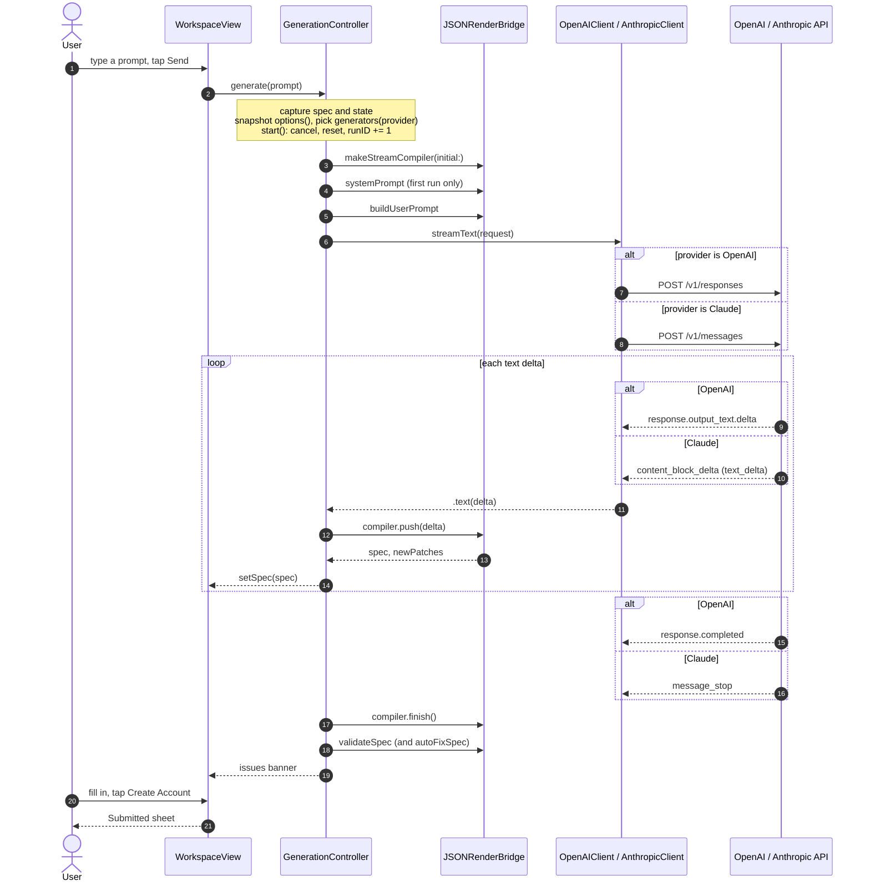
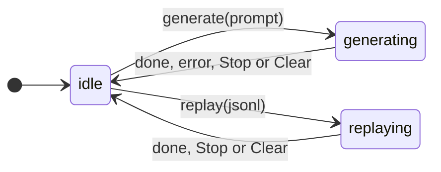
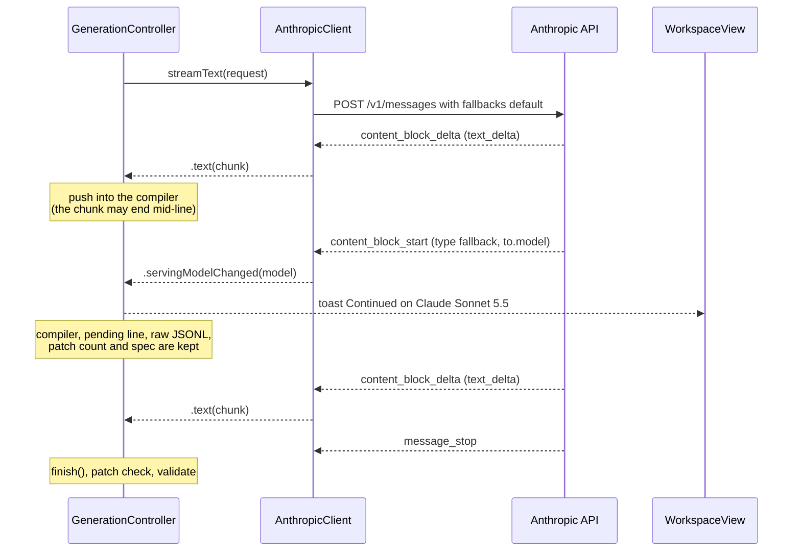

import { Aside, Steps } from "@astrojs/starlight/components";
import Screenshot from "../../../components/Screenshot.astro";
import Screenshots from "../../../components/Screenshots.astro";

This page follows one prompt, "Sign-up form with password confirmation", through the demo app's Form mode, and notes where Document mode and the two providers differ. Almost all of it happens in `GenerationController` (`ios/FormDemo/Models/GenerationController.swift`); the code excerpts on this page are from that file unless their title says otherwise.

## Overview

The pipeline is the same for both providers until the request goes out. The selected provider decides which client streams the text and which events it reads; from the first text delta on, everything is shared.



### Run states

`GenerationController.activity` drives the prompt bar (Send or Stop) and the status capsule:



Stop, Clear and loading an example all go through `cancelRun()`, which also bumps `runID` so the old run can't write any more state. While a run is active the app offers no way to start another one: Send is replaced by Stop, and the Examples menu is disabled.

## Step by step

<Steps>

1. **Send.** `WorkspaceView.send(_:)` trims the text and ignores it if it is empty or a stream is already running. It clears the field, switches to the **UI** tab and calls `controller.generate(text)`:

   ```swift title="ios/FormDemo/Views/WorkspaceView.swift"
   private func send(_ text: String) {
       let text = text.trimmingCharacters(in: .whitespacesAndNewlines)
       guard !text.isEmpty, !controller.isStreaming else { return }
       prompt = ""
       mode = .ui
       controller.generate(text)
   }
   ```

   Each tab has its own `WorkspaceView` and `GenerationController`, so a prompt in the Document tab goes to the document controller and leaves the form workspace untouched.

2. **Capture the edit context and the settings, and start a run.** `generate` decides between a new spec and an edit, and snapshots the provider, model and effort before anything else changes:

   ```swift
   @discardableResult
   func generate(_ prompt: String) -> Task<Void, Never> {
       let prompt = prompt.trimmingCharacters(in: .whitespacesAndNewlines)
       let current = hasSpec ? spec : nil
       // Forms send the live (user-entered) state; a document's state is part of its spec.
       let state = current != nil && kind == .form ? session.store.state : nil
       // Snapshot now: changing provider or model later doesn't affect this run.
       let settings = options()
       let generator = generators(settings.provider)
       return start(.generating(prompt: prompt), initial: current) { bridge, controller, id in
           let instructions = try await controller.cachedSystemPrompt(bridge)
           let input = try await bridge.buildUserPrompt(prompt, currentSpec: current, state: state)
           let request = GenerationRequest(
               model: settings.model,
               instructions: instructions,
               input: input,
               reasoningEffort: settings.reasoningEffort
           )
           // The live client starts its HTTP request as soon as streamText is called.
           try controller.checkCurrent(id)
           return generator.streamText(request)
       }
   }
   ```

   `hasSpec` is true when the current spec has a root. `options()` returns `AppSettings.generationOptions`: the provider, the provider's model (its default when the field is blank) and its effort (`nil` for Model default). `generators(settings.provider)` returns the `OpenAIClient` or the `AnthropicClient`. Both are read here, synchronously, so switching provider or model in Settings while the run starts or streams doesn't change it.

   `start` cancels any previous run, clears the output, starts from an empty spec when this is not an edit, and launches the run:

   ```swift
   private func start(_ activity: Activity, initial: Spec?, makeStream: @escaping StreamFactory) -> Task<Void, Never> {
       cancelRun()
       resetOutput()
       if initial == nil { replaceSpec(with: nil) }
       self.activity = activity
       runID += 1
       let id = runID
       let task = Task {
           await self.run(id: id, initial: initial, makeStream: makeStream)
       }
       self.task = task
       return task
   }
   ```

   `resetOutput()` empties `rawJSONL`, `patchCount`, `errorMessage`, `issues` and `didAutoFix`. `replaceSpec(with: nil)` increments `revision` and gives a form a fresh `FormSession(spec: nil)` or sets a document's spec to `nil`. Each run keeps its own `id`; later code compares it with `runID` to find out whether it has been stopped or superseded.

3. **Create the bridge and the compiler.** The run checks that it is still current, then gets the controller's `JSONRenderBridge` (created on the first run, which loads the SDK's bundled JavaScript into JavaScriptCore, and kept for the controller's lifetime) and a stream compiler that starts from the current spec for an edit or from an empty spec otherwise:

   ```swift
   let bridge: JSONRenderBridge
   let compiler: SpecStreamCompiler
   let stream: AsyncThrowingStream<TextStreamEvent, any Error>
   do {
       bridge = try self.bridge()
       compiler = try await bridge.makeStreamCompiler(initial: initial)
       do {
           try checkCurrent(id)
           stream = try await makeStream(bridge, self, id)
       } catch {
           await compiler.dispose()
           throw error
       }
   } catch {
       if !(error is CancellationError), runID == id { errorMessage = error.localizedDescription }
       return
   }
   ```

   `makeStream` is the closure `generate` passed to `start`. Steps 4 to 6 happen inside it.

4. **Build the system prompt.** `cachedSystemPrompt` asks the bridge once per controller and caches the result:

   ```swift
   private func cachedSystemPrompt(_ bridge: JSONRenderBridge) async throws -> String {
       if let systemPrompt { return systemPrompt }
       let prompt = try await bridge.systemPrompt(customRules: kind.customRules, catalog: kind.catalog)
       systemPrompt = prompt
       return prompt
   }
   ```

   `GenerationKind` supplies both arguments. Forms use the `.swiftui` catalog and one custom rule that tells the model about the app's `log` action; documents use the `.pdf` catalog and no rules:

   ```swift title="ios/FormDemo/Models/GenerationKind.swift"
   var customRules: [String] {
       switch self {
       case .form:
           [#"The app also handles a custom action "log" with params { "message": string, "data"?: any }; it records an analytics event and shows a confirmation toast. Use it only for secondary buttons such as "Save draft", e.g. { "action": "log", "params": { "message": "Draft saved", "data": { "$state": "/form" } } }."#]
       case .document:
           []
       }
   }
   ```

   The same system prompt goes to either provider: OpenAI receives it as `instructions`, Claude as the single `system` text block. [Generation](/json-render-swift/generation/) shows what the rest of the prompt contains.

5. **Build the user prompt.** `bridge.buildUserPrompt(prompt, currentSpec: current, state: state)` runs core's `buildUserPrompt`. For a new spec, `current` and `state` are `nil` and the result is a plain request. When a spec is showing, it goes into the prompt, which puts it into edit mode (see [Follow-up edits](#follow-up-edits)). Forms also pass the live state, so the model sees what the user has entered; documents pass `nil`, because a document's `state` is already part of its spec. OpenAI receives the result as `input`, Claude as the content of the one user message.

6. **Check, then request.** The closure builds a `GenerationRequest` from the snapshot (`model`, `instructions`, `input`, `reasoningEffort`) and checks that the run is still current right before calling `streamText`, because the live clients open their HTTP connection as soon as `streamText` is called. `checkCurrent` throws `CancellationError` when the task was cancelled or `runID` has moved on:

   ```swift
   private func checkCurrent(_ id: Int) throws {
       if Task.isCancelled || runID != id { throw CancellationError() }
   }
   ```

7. **Stream from the provider.** The chosen client resolves its API key (Keychain first, then its environment variable), builds the request and reads the response with `URLSession.bytes(for:)`. Each byte goes into an `SSEParser`, each complete event is decoded, and every text delta is yielded as `.text(String)` to the `AsyncThrowingStream` the controller is reading. The two clients differ in the endpoint, the body and the events they act on; [OpenAI and Claude streams](#openai-and-claude-streams) compares them.

8. **Compile each delta.** The deltas are arbitrary pieces of JSONL; a patch line usually spans several of them. The controller appends each one to the raw text (the **JSONL** tab) and pushes it into the compiler. When a push completes one or more lines, the compiler applies those patches and the controller stores the new spec. A `.servingModelChanged` event only shows a toast ([Claude refusal fallback](#claude-refusal-fallback)):

   ```swift
   var streamError: (any Error)?
   do {
       for try await event in stream {
           try checkCurrent(id)
           switch event {
           case .text(let chunk):
               rawJSONL += chunk
               let update = try await compiler.push(chunk)
               try checkCurrent(id)
               if !update.newPatches.isEmpty {
                   patchCount += update.newPatches.count
                   setSpec(update.spec)
               }
           case .servingModelChanged(let model):
               // The fallback model continues the same output: keep the compiler (and its
               // pending partial line), the raw text, the patches and the spec.
               show(Toast(message: "Continued on \(Provider.anthropic.displayName(forModel: model))",
                          systemImage: "arrow.triangle.2.circlepath"), for: .seconds(4))
           }
       }
       // The stream ends without throwing when its consumer is cancelled.
       try checkCurrent(id)
   } catch {
       streamError = error
   }
   ```

   `setSpec` updates the spec in place. For a form it assigns `session.spec`, which merges state instead of resetting it; for a document it replaces the stored `Spec`:

   ```swift
   private func setSpec(_ spec: Spec) {
       switch kind {
       case .form: session.spec = spec
       case .document: documentSpec = spec
       }
   }
   ```

9. **Render progressively.** As soon as `/root` is set, the "Waiting for the first patch…" spinner gives way to the title, the tabs and the content, and the status capsule counts patches.

   - **Forms.** The first spec with a root seeds the state store; later specs with the same root merge newly streamed `state` into the live state without overwriting values the user has already changed. `JSONRenderView` renders whatever has arrived and skips children whose elements haven't been streamed yet. [Streaming](/json-render-swift/streaming/) explains the merge rules.
   - **Documents.** Rendering a PDF costs more than updating a form, so `PDFPreviewModel` throttles it while the stream runs: a render waits until 0.5 seconds have passed since the last one. `DocumentPreview` calls `show` from a `.task(id:)` keyed by spec, revision and streaming state, so a newer spec cancels the waiting task and takes its place. Outside a stream, specs render at once. A render that finishes after a newer request never replaces the newer document:

     ```swift title="ios/FormDemo/Models/PDFPreviewModel.swift"
     func show(_ spec: Spec?, revision: Int = 0, isStreaming: Bool) async {
         latestRequest += 1
         let request = latestRequest
         if spec == renderedSpec, revision == renderedRevision { return }
         guard let spec else {
             clearDocument()
             return
         }
         if isStreaming, let lastRender {
             let wait = Self.throttle - (ContinuousClock.now - lastRender)
             if wait > .zero {
                 try? await Task.sleep(for: wait)
                 guard !Task.isCancelled else { return }
             }
         }
         do {
             let result = try await PDFRenderer(options: options).renderResult(spec)
             try Task.checkCancellation()
             guard let rendered = PDFDocument(data: result.data) else { throw PreviewError.unreadable }
             // A newer request (another spec, a reset, or this spec already shown) wins.
             guard request == latestRequest else { return }
             document = rendered
             formFields = result.formFields
             renderedSpec = spec
             renderedRevision = revision
             renderError = nil
             lastRender = .now
         } catch is CancellationError {
             return
         } catch {
             if request == latestRequest { renderError = error.localizedDescription }
         }
     }
     ```

   <Screenshots>
     <Screenshot name="06-replay-streaming.png" alt="Create Account with only Email and Password under Account, a 'Replaying stream, 7 patches' capsule and a red stop button" caption="A form after 7 patches: the Account section has its first two fields. The send button is now Stop" width={260} />
     <Screenshot name="document-streaming.png" alt="A partly streamed bank statement with its header, customer line, notice and Summary table, and a 'Replaying stream, 31 patches' capsule" caption="A document after 31 patches: the preview shows the pages streamed so far" width={260} />
   </Screenshots>

10. **Finish the stream.** When the client sees the end of the response (`response.completed` for OpenAI, `message_stop` for Claude), it returns, the stream finishes, and the loop exits. A run that ended with an error, a refusal or a cut-off response doesn't get here (see [Errors and refusals](#errors-and-refusals)). `compiler.finish()` flushes a last line that had no trailing newline, which can apply one more patch:

    ```swift
    // finish() flushes a trailing line without a newline (at most one more patch).
    let final: Spec
    do {
        final = try await compiler.finish()
    } catch {
        if runID == id { errorMessage = error.localizedDescription }
        return
    }
    guard runID == id else { return }
    if final != spec, final.root != nil {
        patchCount += 1
        setSpec(final)
    }
    ```

11. **Check that something arrived.** A model can reply with prose instead of patches. The run fails unless at least one patch was applied, counting one flushed by `finish()`:

    ```swift
    guard patchCount > 0, final.root != nil else {
        errorMessage = initial == nil
            ? "The model returned no \(kind.noun). Try rephrasing your request."
            : "The model didn't change the \(kind.noun). Try rephrasing your request."
        return
    }
    await validate(final, with: bridge, runID: id)
    ```

    `kind.noun` is "form" or "document".

12. **Validate, and auto-fix if needed.** The final spec goes through core's validator against the mode's catalog, with the mode's host actions, so `log` buttons don't produce `unknown_action` warnings. If the spec is invalid, `autoFixSpec` gets one try, and its result is kept only when it is different and has fewer errors:

    ```swift
    let catalog = kind.catalog
    var report = try await bridge.validateSpec(spec, hostActions: kind.hostActions, catalog: catalog)
    if !report.valid {
        let fixed = try await bridge.autoFixSpec(spec, catalog: catalog)
        let fixedReport = try await bridge.validateSpec(fixed, hostActions: kind.hostActions, catalog: catalog)
        if fixed != spec, fixedReport.errorCount < report.errorCount {
            guard runID == id else { return }
            setSpec(fixed)
            didAutoFix = true
            report = fixedReport
        }
    }
    guard runID == id else { return }
    issues = report.issues
    ```

    The remaining issues (errors and warnings) go to `issues`, which shows the validation banner. A typical fix is moving `visible` or `on` out of `props`, where models sometimes put them. `errorCount` is a demo extension on `SpecValidation` that counts issues with `isError`. When the run ends, a `defer` sets `activity` back to `.idle` (if the run is still current), which turns Stop back into Send and, in Document mode, shows **Share PDF** (and **Read filled values** for a fillable document).

13. **Fill in and submit (forms).** The user types; each control writes to the state store through its `$bindState` binding. Tapping **Create Account** emits `press`, which the action dispatcher resolves to `submit` with `params.data` = the current `/form` object. `submit` validates every visible field first. If any fail, their errors appear inline and nothing else happens.

    <Screenshots>
      <Screenshot name="03-validation.png" alt="Create Account with red errors under Email, Password, Confirm Password and Full Name" caption="A failed submit: each visible field shows its first failing check" width={260} />
    </Screenshots>

14. **Show the result (forms).** When every field passes, the dispatcher calls the app's `.onJSONRenderAction("submit")` handler, which finds the state pointer the data came from and stores the data, a summary PDF spec and a fillable PDF spec in `controller.submission`:

    ```swift
    func showSubmission(_ data: JSONValue?, dataRoot: String? = nil, validated: Bool = true, date: Date = .now) {
        let data = data ?? .null
        let state = session.store.state
        let root = dataRoot ?? session.spec.flatMap { SubmissionSummary.dataRoot(in: $0, data: data, state: state) }
        let summary = session.spec.map {
            SubmissionSummary.spec(form: $0, data: data, dataRoot: root, state: state, submittedAt: date)
        }
        let fillable = session.spec.map { FillablePDFMapper.spec(form: $0, data: data, dataRoot: root, state: state) }
        submission = Submission(data: data, validated: validated, summary: summary, fillable: fillable)
    }
    ```

    `WorkspaceView` presents it in the **Submitted** sheet: the data on the **Data** tab, the summary on the **PDF** tab, the fillable form on the **Fillable PDF** tab, and the **Export** menu to share either file. [How the Demo Works](/json-render-swift/demo/#submission-sheet) describes both PDFs.

    <Screenshots>
      <Screenshot name="form-export-pdf.png" alt="The Submitted sheet on the PDF tab with the Summer Party RSVP summary: title, subtitle, submission date, a Field/Value table and 'Page 1 of 1'" caption="The PDF tab of the submission sheet for the RSVP example" width={260} />
      <Screenshot name="form-export-fillable.png" alt="The Submitted sheet on the Fillable PDF tab with the RSVP form as PDF form fields: Name, Email, a Yes/Maybe/No radio group, Guests, Arrival Time and Meal" caption="The Fillable PDF tab: Export as fillable PDF shares this document with your edits" width={260} />
    </Screenshots>

15. **Share or read back the document (documents).** A document has no submit step. Once the run is idle, **Share PDF** in the toolbar shares a `PDFExport` of the current spec, named after the resolved `Document.title`. For a fillable document that the preview shows, the file is a snapshot of the previewed PDF with the user's edits; otherwise the spec is rendered with `PDFRenderer` when the share sheet asks for the file. **Read filled values** reads the edited fields back and **Apply to state** writes the bound ones into the spec's `state` ([Fillable documents](/json-render-swift/demo/#fillable-documents)).

</Steps>

## OpenAI and Claude streams

Both clients implement `TextGenerating`, run the request in a `Task` that is cancelled when the consumer stops listening, read the body with `URLSession.bytes(for:)` and feed it byte by byte into `SSEParser`. They differ in what they send and which events they act on.

### OpenAI (Responses API)

`POST https://api.openai.com/v1/responses` with `Authorization: Bearer <key>`. The body is `model`, `instructions` (the system prompt), `input` (the user prompt), `stream: true`, `store: false`, and `reasoning: { "effort": … }` when an effort is selected.

```swift title="ios/FormDemo/Services/OpenAIClient.swift"
private func run(_ request: GenerationRequest, yield: (String) -> Void) async throws {
    let (bytes, response) = try await session.bytes(for: makeURLRequest(request))
    guard let http = response as? HTTPURLResponse else { throw OpenAIError.invalidResponse }
    guard (200..<300).contains(http.statusCode) else {
        var body = Data()
        for try await byte in bytes {
            body.append(byte)
            if body.count >= 64 * 1024 { break }
        }
        throw OpenAIError.http(status: http.statusCode, message: OpenAIError.message(fromErrorBody: body))
    }

    var parser = SSEParser()
    var refusal: String?
    for try await byte in bytes {
        guard let event = parser.push(byte) else { continue }
        if try handle(event, refusal: &refusal, yield: yield) { return }
    }
    if let event = parser.finish(), try handle(event, refusal: &refusal, yield: yield) { return }
    try Task.checkCancellation()
    throw OpenAIError.streamEndedEarly
}
```

- `response.output_text.delta` yields its text.
- `response.refusal.delta` collects refusal text and `response.refusal.done` replaces it with the complete text. The client throws `refused` when `response.completed` arrives, so the banner shows the whole refusal.
- `response.completed` (or `data: [DONE]`) ends the stream.
- `response.failed`, `response.incomplete` and `error` throw `streamFailed`.

### Claude (Messages API)

`POST https://api.anthropic.com/v1/messages` with `x-api-key: <key>` and `anthropic-version: 2023-06-01`. The body is `model`, `max_tokens: 64000`, `stream: true`, `system` (one text block with the system prompt and `cache_control: {type: "ephemeral"}`), `messages` (one user message with the user prompt), `output_config: { "effort": … }` when an effort is selected, and, for `claude-opus-5-5` and `claude-sonnet-5-5`, `fallbacks: "default"` with the `anthropic-beta: server-side-fallback-2026-07-01` header.

```swift title="ios/FormDemo/Services/AnthropicClient.swift"
/// Returns `true` once the message is complete.
private func handle(_ event: SSEEvent, yield: (TextStreamEvent) -> Void) throws -> Bool {
    switch try AnthropicStreamEvent(event) {
    case .textDelta(let text):
        if !text.isEmpty { yield(.text(text)) }
    case .fallback(let model):
        yield(.servingModelChanged(model: model))
    case .stop(let reason, let explanation):
        switch reason {
        case "refusal": throw AnthropicError.refused(explanation ?? "")
        case "max_tokens": throw AnthropicError.cutOff
        case "model_context_window_exceeded": throw AnthropicError.contextWindowExceeded
        default: break
        }
    case .messageStop:
        return true
    case .error(let type, let message):
        throw AnthropicError.streamError(type: type, message: message)
    case .ignored:
        break
    }
    return false
}
```

- `content_block_delta` with a `text_delta` yields its text. Thinking blocks, `ping`, `message_start` and block stops are ignored.
- A `content_block_start` of type `fallback` yields `.servingModelChanged(model:)`.
- `message_delta` with `stop_reason` `refusal` throws `refused` with `stop_details.explanation`; `max_tokens` and `model_context_window_exceeded` throw cut-off errors; other stop reasons (such as `end_turn`) continue to `message_stop`.
- `message_stop` ends the stream. An `error` event throws `streamError`.

The HTTP status check before the event loop is the same as OpenAI's, except that the body and the `retry-after` header go to `AnthropicError.http(status:body:retryAfter:)`.

[How the Demo Works](/json-render-swift/demo/#services) has the full request bodies and event tables.

## Claude refusal fallback

Requests to `claude-opus-5-5` and `claude-sonnet-5-5` opt in to server-side refusal fallback. When the API switches the response to a fallback model, the stream carries a `fallback` content block, and the fallback model's text continues the same output in later content blocks. The app treats the switch as a notification, not a restart:



- `AnthropicStreamEvent` reads the new model from `content_block.to.model`, else `content_block.model`, else uses "another model".
- The controller shows "Continued on `<name>`" with the `arrow.triangle.2.circlepath` symbol for 4 seconds. The name is the model's display name from `Provider.anthropic` ("Claude Sonnet 5.5"), or the ID itself for a model the app doesn't list.
- Nothing else changes: the same compiler keeps receiving text, so a JSONL line that was half-received before the switch is completed by the fallback model's text. The JSONL tab and the patch count include both parts, and the run finishes and validates as usual.
- Without a fallback, a refusal ends the stream with `stop_reason: "refusal"`, which is an error: "The model declined: …" with `stop_details.explanation`. Patches that arrived before it stay.
- `claude-fable-5`, `claude-haiku-5-5` and custom model IDs don't send `fallbacks`, so they only have the refusal path.

`GenerationPipelineTests` covers a fallback between two complete lines, in the middle of a JSONL line, during an edit, and end to end through `AnthropicClient` with a stubbed stream.

## Document mode

Document runs use the same controller class and the same code path. The differences all come from `GenerationKind.document` and the views:

| Step | Form | Document |
|---|---|---|
| System prompt | `systemPrompt(customRules: [log rule], catalog: .swiftui)` | `systemPrompt(customRules: [], catalog: .pdf)` |
| User prompt in edit mode | Current spec and live state | Current spec only |
| Where the spec lives | `session.spec` (a `FormSession`) | `documentSpec` (a `Spec`) |
| Rendering while streaming | `JSONRenderView`, on every applied patch | `DocumentPreview` and `PDFPreviewModel`, at most every 0.5 s |
| Validation | `validateSpec(_:hostActions: ["log"], catalog: .swiftui)` | `validateSpec(_:hostActions: [], catalog: .pdf)` |
| Auto-fix | `autoFixSpec(_:catalog: .swiftui)` | `autoFixSpec(_:catalog: .pdf)` |
| Result | Submission sheet with Data, PDF and Fillable PDF tabs | **Share PDF**, and **Read filled values** for fillable documents |
| Empty reply message | "The model returned no form. …" | "The model returned no document. …" |

## Follow-up edits

When a spec is showing, the prompt bar reads "Ask for a change…" and the next prompt edits that spec instead of replacing it:

- `buildUserPrompt` receives the current spec (and, for forms, the live state), so core's prompt asks for patches against the existing spec.
- The compiler starts from the current spec, so a patch such as `{"op":"add","path":"/elements/account/children/-","value":"phone"}` or `{"op":"replace","path":"/elements/doc/props/title","value":"Invoice #2001"}` applies to it.
- `start` doesn't call `replaceSpec`, so a form keeps its `FormSession` and the `revision` doesn't change. The root doesn't change, so state isn't re-seeded: newly streamed `state` values are merged in, and values the user typed survive. Fields that were already validated re-validate against the new checks, and validation results for fields that were removed or rebound are cleared.
- In Document mode the preview re-renders once the edited spec differs, so values typed into a fillable document's fields and not applied to state are replaced by the new render.
- The JSONL tab and the patch count show only the edit's patches.
- If the model answers without patches, the banner says "The model didn't change the form. Try rephrasing your request." (or "document") and the spec is left as it was. An edit whose only patch arrives without a trailing newline is applied by `finish()` and counts as a change.

To start over instead, use **⋯ → Clear**, which asks for confirmation, then empties the workspace.

## Cancellation

Tapping **Stop** calls `controller.stop()`, which calls `cancelRun()`:

```swift
private func cancelRun() {
    task?.cancel()
    task = nil
    runID += 1
    activity = .idle
}
```

- The UI returns to idle immediately, because `activity` is reset here rather than when the task finishes.
- Cancelling the task ends the `for try await` loop. The stream's `onTermination` cancels the client's inner task, which cancels the `URLSession` request. The `checkCurrent` after the loop then throws `CancellationError`.
- On any `CancellationError` or other stream error, the run calls `compiler.dispose()`, which frees the JavaScript compiler without flushing, and returns. The partial form or document stays on screen; a cancellation shows no banner.
- `runID` guards every write that follows an `await`. A chunk that arrives after Stop fails `checkCurrent` and is never pushed, and a stale run can't set `errorMessage`, `issues` or the spec of a newer run.
- Loading an example and **Clear** call `cancelRun()` first, so they supersede a running stream the same way. Starting a run or a replay does too, through `start`.

A run that is cancelled before it reaches `streamText` sends no request. The run checks at its start, after creating the compiler, and right before `streamText`, so Stop during the bridge calls disposes the compiler and returns without touching the network. `GenerationPipelineTests` checks this with a counting `URLProtocol`: 20 runs stopped right after they start open no connections.

## Errors and refusals

Every failure ends up as `errorMessage`, which shows the "Something went wrong" banner. The stream-error path disposes the compiler without `finish()`, skips the patch check and skips validation, so the spec keeps whatever patches were applied before the failure, and a trailing line without a newline is dropped. When the selected provider has no key, the banner also has a **Settings** button.

| Where | Provider | Cause | Message |
|---|---|---|---|
| Request | OpenAI | No key in the Keychain or `OPENAI_API_KEY`, or a blank one | No OpenAI API key. Add one in Settings, or put OPENAI_API_KEY in ios/Secrets.xcconfig. |
| Request | Claude | No key in the Keychain or `ANTHROPIC_API_KEY`, or a blank one | No Anthropic API key. Add one in Settings, or put ANTHROPIC_API_KEY in ios/Secrets.xcconfig. |
| Response | Both | Not an HTTP response | The server did not return an HTTP response. |
| Response | OpenAI | Non-2xx status | OpenAI returned HTTP 401 (unauthorized): Incorrect API key provided… |
| Response | Claude | 401 | Anthropic rejected the API key (HTTP 401): invalid x-api-key |
| Response | Claude | 429 | Rate limited by Anthropic (HTTP 429). Retry after 20 s. `<message>` ("Try again shortly." without `retry-after`) |
| Response | Claude | 529 | Anthropic is overloaded. Try again shortly: `<message>` |
| Response | Claude | Other 5xx | Anthropic server error (HTTP 500): `<message>` |
| Response | Claude | Any other non-2xx | Anthropic returned HTTP 400 (bad request): `<message>` |
| Stream | Both | An event's data isn't JSON | Could not decode stream event `<event>`: `<detail>` |
| Stream | OpenAI | `response.failed` | `response.error.message`, or "The response failed." |
| Stream | OpenAI | `response.incomplete` (cut off) | Response was cut off (`<reason>`). What arrived is kept; ask for the rest in a follow-up. |
| Stream | Claude | `stop_reason: "max_tokens"` (cut off) | Response was cut off: the model reached max_tokens. What arrived is kept; ask for the rest in a follow-up. |
| Stream | Claude | `stop_reason: "model_context_window_exceeded"` (cut off) | Response was cut off: the model's context window is full. What arrived is kept; try a shorter request or clear and start over. |
| Stream | OpenAI | `error` event | Its `message` or `error.message`, or "The stream reported an error." |
| Stream | Claude | `error` event | `error.message` (or "The stream reported an error."); for `overloaded_error`: Anthropic is overloaded. Try again shortly: `<message>` |
| Stream | OpenAI | Refusal, reported at `response.completed` | The model declined: `<refusal text>` (or "The model declined this request.") |
| Stream | Claude | `stop_reason: "refusal"` | The model declined: `<stop_details.explanation>` (or "The model declined this request.") |
| Stream | Claude | `fallback` content block | Not an error: a "Continued on `<model>`" toast, and the stream continues. |
| Stream | Both | Bytes end before `response.completed` / `[DONE]` or `message_stop` | The stream ended before the response completed. |
| Network | Both | `URLSession` error (offline, timeout) | The system's localized description. |
| Result | Both | No patches for a new spec | The model returned no form. Try rephrasing your request. (or document) |
| Result | Both | No patches for an edit | The model didn't change the form. Try rephrasing your request. (or document) |
| Validation | Both | The bridge threw while validating | Validation failed: `<description>` |
| Examples | None | A bundled fixture is missing | `<name>.json` is missing from the app bundle. |

For HTTP errors, both clients read up to 64 KB of the body and take `error.message` from the provider's JSON error format; if the body isn't in that format, the first 500 characters of the text are used instead, and an empty body gives no message (the text then ends with a period).

A refused edit leaves the current spec unchanged when the refusal arrives before any patch. A cut-off response keeps the patches that arrived, and because the run isn't treated as complete, there is no validation banner.

A PDF that fails to render is not a run error: `DocumentPreview` shows the renderer's message in an orange capsule over the preview and keeps the last good document. A failure to read a fillable document's values shows "Couldn't read the form: …" in the error banner.

## Replay mode

**Replay stream** runs the same pipeline with a different text source:

```swift
func replay(_ jsonl: String, delay: Duration = .milliseconds(25)) -> Task<Void, Never> {
    start(.replaying, initial: nil) { _, _, _ in
        ReplayStream.stream(ReplayStream.chunks(of: jsonl), delay: delay)
    }
}
```

`WorkspaceView` passes the chosen recording: the empty screen's **Replay stream** and `-replay` without an ID play the mode's first one (`registration.jsonl` for forms, `statement.jsonl` for documents), and **Examples → Recorded streams** also offers `application-form.jsonl` in Document mode. `initial: nil` means a replay always starts a new spec (a fresh session for forms, a new revision), even when one is showing. The stream factory skips steps 4 to 7: there is no provider, no system prompt, no user prompt and no network. From step 8 on, everything is identical: the chunks (4 to 27 characters, deterministic) are appended to the JSONL tab, pushed through the compiler, rendered progressively, flushed, checked for patches and validated. The status capsule reads "Replaying stream" instead of "Generating", and **Stop** works the same way.

Because the code path is shared, the tests feed `registration.jsonl`, `statement.jsonl` and `application-form.jsonl` through the pipeline in replay-sized chunks and expect exactly `registration.json`, `statement.json` and `application-form.json`.

<Aside type="tip">
**Examples** don't use this pipeline. `controller.load(_:)` cancels any run, replaces the spec (a new `FormSession` for forms, a new revision for both) and then validates it, so the validation banner works for examples, but the JSONL tab stays empty.

```swift
func load(_ spec: Spec) {
    cancelRun()
    resetOutput()
    replaceSpec(with: spec)
    let id = runID
    Task {
        guard let bridge = try? self.bridge() else { return }
        await self.validate(spec, with: bridge, runID: id)
    }
}
```
</Aside>

## Next

- [How the Demo Works](/json-render-swift/demo/): the screen, the providers and the types involved.
- [Generating with OpenAI](/json-render-swift/guides/openai/): build the same pipeline in your own app.
- [Streaming](/json-render-swift/streaming/): the stream compiler and state merging.
- [JSONRenderBridge](/json-render-swift/api/swift/json-render-bridge/): `systemPrompt`, `buildUserPrompt`, `validateSpec` and `autoFixSpec`.
