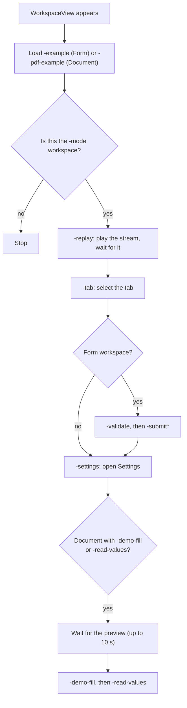

import { Aside, Steps } from "@astrojs/starlight/components";
import Screenshot from "../../../components/Screenshot.astro";
import Screenshots from "../../../components/Screenshots.astro";

This page covers building and running FormDemo, configuring OpenAI and Claude, opening the app in a known state with launch arguments, and running its tests. [How the Demo Works](/json-render-swift/demo/) describes the app itself.

## Requirements

| Requirement | Version |
|---|---|
| Xcode | 27 |
| [XcodeGen](https://github.com/yonaskolb/XcodeGen) | Any recent version (`brew install xcodegen`) |
| Simulator or device | iOS 26 or later (the deployment target is iOS 26.0) |
| API key | An OpenAI key, an Anthropic key, or both. Only for generating forms and documents; examples and recorded streams work without one. |

The app uses the SDK as a local Swift package (`../swift/JSONRender`, products `JSONRenderSwiftUI` and `JSONRenderPDF`) and has no other dependencies. Both API clients use `URLSession` directly. You don't need Node: the SDK's JavaScript bundle is checked in.

## Build and run

<Steps>

1. Generate the Xcode project from `ios/project.yml`:

   ```bash
   cd ios
   xcodegen generate
   ```

   This writes `FormDemo.xcodeproj` with two targets, `FormDemo` (the app) and `FormDemoTests` (unit tests hosted by the app), and a shared `FormDemo` scheme. Both build configurations of the app target use `FormDemo.xcconfig`. Run `xcodegen generate` again after adding or removing source files.

2. Open the project and run the **FormDemo** scheme on an iOS 26 simulator:

   ```bash
   open FormDemo.xcodeproj
   ```

3. Without a key, tap **Examples** or **Replay stream** on the first screen of either tab. To generate forms and documents, add a key for at least one provider as described below.

</Steps>

To build and run the tests from the command line:

```bash
xcodebuild -project FormDemo.xcodeproj -scheme FormDemo \
  -destination 'platform=iOS Simulator,name=iPhone 18 Pro,OS=27.0' build test
```

Change the destination's `name` and `OS` to a simulator you have installed (`xcrun simctl list devices available`).

The bundle identifier is `dev.jsonrender.FormDemo` and the display name is "Form Demo". Code signing is automatic with no team set, which is enough for the simulator; set a development team in `project.yml` (`DEVELOPMENT_TEAM`) to run on a device.

## API keys

Each provider has its own key. A key is looked up each time a request for that provider is built, in this order:

1. **The Keychain.** Open **⋯ → Settings**, select the provider, paste the key into the **OpenAI API key** or **Claude API key** field and tap **Save to Keychain** (or press Return). The key is trimmed and stored on this device only.
2. **The provider's environment variable.** For runs from Xcode, set it through `Secrets.xcconfig`, described next. A key saved in the Keychain takes precedence.

| | OpenAI | Claude |
|---|---|---|
| Keychain item | service `dev.jsonrender.FormDemo`, account `openai-api-key` | service `dev.jsonrender.FormDemo`, account `anthropic-api-key` |
| Environment variable | `OPENAI_API_KEY` | `ANTHROPIC_API_KEY` |
| Field placeholder | `sk-…` | `sk-ant-…` |
| Sent as | `Authorization: Bearer <key>` | `x-api-key: <key>` |

Keychain items are generic passwords, accessible after first unlock on this device only. An empty value in either place counts as no key. The Settings footer under the key field shows which key is in use:

| Situation | Footer |
|---|---|
| A key is saved in the Keychain | A key ending in …abcd is stored in the Keychain. (and a **Remove** button deletes it) |
| Only the environment variable is set | Using OPENAI_API_KEY from Secrets.xcconfig. A key saved here takes precedence. (or ANTHROPIC_API_KEY) |
| Neither | No key yet. Offline examples and Replay stream work without one. |

With no key for the selected provider, sending a prompt shows "No OpenAI API key. Add one in Settings, or put OPENAI_API_KEY in ios/Secrets.xcconfig." (or the Anthropic equivalent) with a **Settings** button.

### Secrets.xcconfig

Put the keys in an untracked build-settings file next to `project.yml`:

```bash
cat > ios/Secrets.xcconfig <<'KEYS'
OPENAI_API_KEY = sk-...
ANTHROPIC_API_KEY = sk-ant-...
KEYS
```

Leave out the line for a provider you don't use. `ios/.gitignore` ignores `Secrets.xcconfig`. The keys reach the app through three files:

| File | Tracked | What it does |
|---|---|---|
| `ios/Secrets.xcconfig` | No | Defines the `OPENAI_API_KEY` and `ANTHROPIC_API_KEY` build settings with your keys. |
| `ios/FormDemo.xcconfig` | Yes | Defines `OPENAI_API_KEY =` and `ANTHROPIC_API_KEY =` (empty), then `#include? "Secrets.xcconfig"`. The `?` makes the include optional, so the project builds without the file and the keys are empty. |
| Shared `FormDemo` scheme (generated from `project.yml`) | Yes | Sets the run environment variables `OPENAI_API_KEY` and `ANTHROPIC_API_KEY` to `$(OPENAI_API_KEY)` and `$(ANTHROPIC_API_KEY)`, which Xcode expands from the build settings when it launches the app. |

The keys are not compiled into the app: they exist only in the environment of a process that Xcode launches with this scheme. Edit `Secrets.xcconfig` and run again to change them.

To pass a key to an app you launch with `simctl`, prefix the variable with `SIMCTL_CHILD_`:

```bash
SIMCTL_CHILD_ANTHROPIC_API_KEY=sk-ant-... xcrun simctl launch booted dev.jsonrender.FormDemo
```

<Aside type="danger" title="Never commit a key">
Don't paste a key into **Edit Scheme → Run → Arguments**. The scheme lives in `FormDemo.xcodeproj/xcshareddata`, which is committed, and `project.yml` already sets both variables from the build settings. Use `Secrets.xcconfig` or the Keychain.
</Aside>

## Provider, model and effort

<Screenshots>
  <Screenshot name="09-settings.png" alt="Settings with OpenAI selected: the provider picker, the OpenAI API key field with Save to Keychain and 'No key yet', Model gpt-6-luna, Effort Model default with the reasoning.effort footer, and Endpoint POST /v1/responses" caption="OpenAI selected, no key saved, default model" width={260} />
  <Screenshot name="09-settings-claude.png" alt="Settings with Claude selected: the Claude API key field, Model Claude Sonnet 5.5, Effort Model default with the output_config.effort footer, and Endpoint POST /v1/messages" caption="Claude selected, no key saved, default model" width={260} />
</Screenshots>

Settings has four sections, all for the provider selected at the top:

- **Provider**: a segmented **OpenAI** / **Claude** picker. Footer: "Used by both Form and Document. A running generation keeps the provider it started with." Until you pick one, the app uses OpenAI, unless only a Claude key is configured. The choice is saved under the `UserDefaults` key `provider`.
- **API key**: the key field, **Save to Keychain**, **Remove** and the status footer described above. Switching providers clears the field.
- **Model**: a **Model** picker with the provider's models and **Custom…**, and an **Effort** picker.
- **Endpoint** (informational): **API** `POST /v1/responses` or `POST /v1/messages`, **Streaming** "Server-sent events".

| | OpenAI | Claude |
|---|---|---|
| Models | `gpt-6-astra`, `gpt-6.1-sol`, `gpt-6-luna` | Claude Fable 5 (`claude-fable-5`), Claude Opus 5.5 (`claude-opus-5-5`), Claude Sonnet 5.5 (`claude-sonnet-5-5`), Claude Haiku 5.5 (`claude-haiku-5-5`) |
| Default model | `gpt-6-luna` | `claude-sonnet-5-5` |
| Efforts | Model default, Low, Medium, High | Model default, Low, Medium, High, Extra high (`xhigh`), Max |
| Effort sent as | `reasoning.effort` | `output_config.effort` |
| Effort footer | "Effort is sent as reasoning.effort; Model default sends none. Supported efforts aren't verified for these model IDs; use Model default if the API rejects one." | "Effort is sent as output_config.effort; Model default sends none. Low or medium is plenty for forms and documents. Opus 5.5 and Haiku 5.5 default to medium." For a custom ID it adds "Efforts aren't verified for custom model IDs." |
| Saved under | `openai.model`, `openai.effort` | `anthropic.model`, `anthropic.effort` |

- **Custom model IDs.** Choosing **Custom…** shows a **Model ID** text field (monospaced, with the default model as placeholder). The ID you type is saved as that provider's model; a blank field requests the default model. When Settings opens with a saved ID that isn't in the list, the picker shows **Custom…** with the field.
- **Model default** sends no effort parameter. Each effort list is fixed per provider, not per model. A saved effort that the provider doesn't offer resets to Model default at launch and when the model changes.
- **Per provider.** Switching providers shows that provider's saved model, effort and key, and switching back restores the others.
- **When it applies.** The provider, model and effort are read when each generation starts, in both modes, so a change applies to the next prompt. A generation that is already running keeps its settings.

## Offline use

Each mode has features that need no key and no network:

| Mode | Examples | Recorded streams |
|---|---|---|
| Form | Registration, Event RSVP, Feedback Survey, Shipping Address (`fixtures/specs/*.json`) | Replay registration (`fixtures/specs/registration.jsonl`) |
| Document | Invoice, Quarterly Report, Resume, Business Letter, Bank Statement, Rental Application (fillable) (`fixtures/pdf/*.json`) | Replay bank statement (`fixtures/pdf/statement.jsonl`), Replay fillable application (`fixtures/pdf/application-form.jsonl`) |

- **Examples** (toolbar, or the button on the empty screen) loads a finished spec directly and validates it, so the JSONL tab stays empty. See the [form examples](/json-render-swift/examples/) and [document examples](/json-render-swift/pdf/examples/).
- **Recorded streams** (toolbar **Examples** menu) and **Replay stream** (empty screen, the mode's first recording) play a recording through the real compiler pipeline, in chunks of 4 to 27 characters with 25 ms between them. You see the spec build, the patch counter, Stop, the JSONL tab, the throttled PDF preview and the validation step exactly as in a live generation.
- The fillable features (filling in the preview, **Read filled values**, **Apply to state**, **Share PDF** with edits, and the submission sheet's **Fillable PDF** tab) work offline too.

Both read the files from the app bundle: `project.yml` adds `../fixtures/specs` and `../fixtures/pdf` (without `reference/`) as resources, so edits to the fixtures show up on the next build.

## Launch arguments

Launch arguments open the app in a known state, for demos and screenshots.

| Argument | Effect |
|---|---|
| `-mode form\|document` | The tab selected at launch. Default `form`; other values are ignored. |
| `-example <id>` | Load a form: `registration`, `event-rsvp`, `feedback-survey` or `shipping-address`. Unknown IDs are ignored. |
| `-pdf-example <id>` | Load a document: `invoice`, `report`, `resume`, `letter`, `statement` or `application-form`. Unknown IDs are ignored. |
| `-replay [id]` | Play a recorded stream of the `-mode` workspace and wait for it to finish. Without an ID (or when the next argument starts with `-`), the mode's first recording: `registration` for forms, `statement` for documents. Documents also have `application-form`. An unknown ID shows "`<id>`.jsonl is missing from the app bundle." |
| `-tab ui\|json\|jsonl` | Select the initial tab of the `-mode` workspace. Other values are ignored. |
| `-validate` | Run `validateAll()` on the loaded form, which shows the inline errors. Form mode only. |
| `-submit` | Open the submission sheet on the **Data** tab with the current `/form` state (the whole state if there is no `/form`). The submit action and its validation don't run, and the sheet says so. Form mode only. |
| `-submit-pdf` | Same as `-submit`, opened on the **PDF** tab. Implies `-submit`. |
| `-submit-fillable` | Same as `-submit`, opened on the **Fillable PDF** tab. Implies `-submit`. |
| `-settings` | Open Settings over the `-mode` workspace. |
| `-demo-fill` | Type sample values into the document's text fields, as a user would: `firstName` Alex, `lastName` Rivera, `employer` Contoso Ltd. (matched by field name or its last component). Document mode only. |
| `-read-values` | Open the Filled values sheet once the document has rendered. Document mode only. |
| `-provider openai\|anthropic` | Use this provider for this launch without saving it. |

`LaunchOptions` parses every argument except `-provider`. That one works through `UserDefaults`: a `-key value` launch argument goes into the volatile argument domain of `UserDefaults.standard`, and `AppSettings` reads the `provider` key from there at launch. It overrides a saved choice for that launch only; picking a provider in Settings during the launch still applies and is saved.

`-mode` is read when the app starts. Each workspace applies the rest once, when its view first appears, in a fixed order:



Each step runs only when its argument is present. Consequences of the order:

- `-example` and `-pdf-example` load into their own workspace whatever `-mode` is, so one launch can prepare both tabs. A workspace that isn't selected at launch applies them when you first switch to its tab.
- `-replay` replaces a loaded example in the same workspace, because a replay always starts a new spec.
- `-demo-fill` and `-read-values` wait, in 100 ms steps for at most 10 seconds, until the preview shows the current document. The preview renders only on the **UI** tab, so combine them with the default tab.

With the app installed on a booted simulator (run it once from Xcode):

```bash
xcrun simctl launch booted dev.jsonrender.FormDemo -mode document -pdf-example application-form -demo-fill -read-values
```

Add `--terminate-running-process` after `launch` if the app is already running. In Xcode, add the arguments under **Edit Scheme → Run → Arguments → Arguments Passed On Launch**.

### Reproducing the screenshots

These arguments put the app in the state shown in each screenshot in these docs:

| Screenshot | Arguments |
|---|---|
| `01-empty.png` | none |
| `02-registration.png` | `-example registration` |
| `03-validation.png` | `-example registration -validate` |
| `04-event-rsvp.png` | `-example event-rsvp` |
| `05-json.png` | `-example event-rsvp -tab json` |
| `06-replay-streaming.png` | `-replay`, captured while the stream runs |
| `07-jsonl.png` | `-replay -tab jsonl` |
| `08-submitted.png` | `-example event-rsvp -submit` |
| `09-settings.png` | `-settings -provider openai`, with no OpenAI key |
| `09-settings-claude.png` | `-settings -provider anthropic`, with no Anthropic key |
| `10-shipping.png` | `-example shipping-address` |
| `11-feedback.png` | `-example feedback-survey` |
| `document-empty.png` | `-mode document` |
| `document-invoice.png` | `-mode document -pdf-example invoice` |
| `document-json.png` | `-mode document -pdf-example statement -tab json` |
| `document-streaming.png` | `-mode document -replay`, captured while the stream runs |
| `document-fillable.png` | `-mode document -pdf-example application-form` |
| `document-filled-values.png` | `-mode document -pdf-example application-form -demo-fill -read-values` |
| `form-export-pdf.png` | `-example event-rsvp -submit-pdf` |
| `form-export-fillable.png` | `-example event-rsvp -submit-fillable` |

Capture with `xcrun simctl io booted screenshot <file>.png`. The screenshots show a 9:41 status bar; `xcrun simctl status_bar booted override --time 9:41` sets it.

## Tests

`FormDemoTests` uses Swift Testing. The test target is hosted by the app (`TEST_HOST`), so the bundled fixtures are available and the tests import the SDK from the app. No test talks to OpenAI or Anthropic: network tests use a stubbed `URLProtocol`, and pipeline tests use a scripted `MockGenerator` that conforms to `TextGenerating`.

| Suite | File | Covers |
|---|---|---|
| SSE parser | `SSEParserTests.swift` | Typed events; identical results for every chunk size from 1 to 12 bytes, including multi-byte UTF-8 split across chunks; LF, CRLF and CR line endings; multi-line `data:`; comments, `retry:` and events without data ignored; an unterminated final event flushed by `finish()`. |
| Responses stream events | `SSEParserTests.swift` | Text deltas; `response.completed` and `[DONE]`; `error` (flat and nested message), `response.failed`, `response.incomplete`; refusal delta and done; the SSE event name as fallback type; malformed JSON throws. |
| OpenAI client | `OpenAIClientTests.swift` | Request URL, method and headers, and the exact JSON body keys (`model`, `instructions`, `input`, `stream`, `store`, plus `reasoning` only with an effort); missing, empty and blank keys. Over a stubbed `URLProtocol`: streamed deltas, HTTP 401 with the API's message, `response.failed`, refusals, a truncated stream; error-body parsing. |
| Anthropic client | `AnthropicClientTests.swift` | The exact request for Haiku 5.5 (URL, `x-api-key`, `anthropic-version`, no `anthropic-beta`, no `Authorization`, the JSON body with `cache_control`); `fallbacks` and the beta header for Opus 5.5 and Sonnet 5.5 only; `output_config` only with an effort; never `thinking`, `temperature`, `top_p`, `top_k` or a prefill, for any model and effort; missing keys. Event decoding; streamed text with thinking blocks and pings ignored; a fallback block yields `.servingModelChanged`; refusal with explanation; `max_tokens` and `model_context_window_exceeded` as cut-off; a mid-stream `error`; a truncated stream; HTTP 401, 429 with `retry-after`, 529, 5xx and other statuses. |
| Settings | `AppSettingsTests.swift` | Defaults (`gpt-6-luna`, `claude-sonnet-5-5`, the model lists); efforts per provider and whether they are verified; the default provider follows the configured keys and an explicit choice wins; switching providers keeps each one's model and effort, also after a restart; custom model IDs persist and a blank one falls back to the default; an unsupported saved effort resets; keys are per provider; Model default sends no `reasoning`. |
| Generation pipeline | `GenerationPipelineTests.swift` | Form mode. `registration.jsonl` in replay-sized chunks produces exactly `registration.json`; the form builds progressively and Stop cancels the stream; edit mode sends the current spec and state and keeps user input; stopping or superseding a run before it starts sends no request, and with the real client opens no connection in 20 tries; refused and prose-only edits are reported and leave the form unchanged; an edit whose only patch is flushed by `finish()` succeeds; a fallback continues the output and shows "Continued on Claude Sonnet 5.5", including inside a JSONL line, during an edit and through `AnthropicClient`; cut-off responses for both providers are errors that keep the partial edit and skip validation; the provider is chosen when the run starts; stream errors and prose-only replies are reported; `autoFixSpec` repairs a misplaced `visible`; a handled custom action (`log`) produces no validation issues; replay uses the same pipeline; examples load into a fresh session. |
| Document mode | `DocumentModeTests.swift` | `statement.jsonl` in chunks produces exactly `statement.json` with the PDF catalog's system prompt (no form components, no `log` rule) and renders to a PDF of at least two pages; an edit sends the current document and applies its patch; a prose reply reports "The model returned no document."; Stop keeps the partial document; every document example passes `validateSpec(catalog: .pdf)`; `PDFExport` names the file from the resolved `$template` title, replaces unsafe characters and falls back to `Document.pdf`. |
| Modes | `DocumentModeTests.swift` | The form and document controllers keep independent spec, stream, state and errors; launch arguments parse (`-mode`, `-pdf-example`, `-tab`, `-submit-pdf`). |
| Submission summary PDF | `DocumentModeTests.swift` | One row per visible field in order, with option labels, Yes/No, masked passwords and hidden fields skipped; values come from the submitted data, resolved against its exact root; template labels drop a trailing value placeholder; the summary spec passes PDF validation and renders the title, labels and "Page 1 of 1"; the controller attaches the summary and marks `-submit` sheets as not validated. |
| Fillable PDF | `FillablePDFTests.swift` | The mapper covers every SwiftUI component type, and the mapped spec validates and renders; the field names of the mapped registration (6) and RSVP (7, or 8 once a hidden field becomes visible) forms; the submission carries the fillable export, named `Summer Party RSVP (fillable).pdf`; a read-back round trip through `PDFPreviewModel` (edits, unbound fields, apply to state, re-render); a stale render never replaces a newer document; reset and new revisions drop cached edits; export snapshots the edited document and falls back to rendering; `application-form.jsonl` compiles to exactly `application-form.json`. |

Run them with **Product → Test** in Xcode, or with the `xcodebuild … build test` command above. The SDK's own tests run separately, with `xcrun swift test` or `xcodebuild -scheme JSONRender-Package … test` in `swift/JSONRender`.

## Next

- [How the Demo Works](/json-render-swift/demo/): the screen, the providers, the types and the SDK hooks.
- [Life of a Prompt](/json-render-swift/demo/prompt-lifecycle/): the pipeline step by step, for both providers.
- [Examples](/json-render-swift/examples/) and [PDF examples](/json-render-swift/pdf/examples/): the specs behind the Examples menus.
- [Generating with OpenAI](/json-render-swift/guides/openai/): the same approach in your app.
