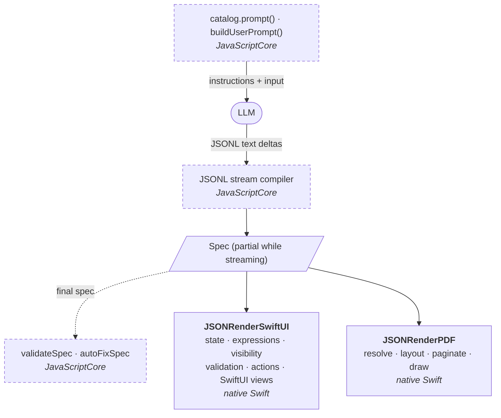

import { Card, CardGrid, LinkCard } from "@astrojs/starlight/components";
import Screenshot from "../../components/Screenshot.astro";
import Screenshots from "../../components/Screenshots.astro";

json-render for Swift lets a language model generate **native iOS forms** and **PDF documents**. It has two renderers: SwiftUI for forms and PDF for documents. The model writes a [json-render](https://github.com/vercel-labs/json-render) spec against a catalog, and a Swift package renders it natively: `JSONRenderSwiftUI` draws forms with real SwiftUI controls, two-way state binding, validation, visibility rules and actions, and `JSONRenderPDF` lays out and paginates documents built from the PDF catalog.

## Why

Asking a model for SwiftUI code gives you code you have to compile, review and ship. Asking it for free-form JSON gives you a structure you have to invent and police. json-render sits in between: you publish a **catalog** of components and actions, the model emits a **spec** that can only use that catalog, and a renderer you control turns the spec into UI. No generated code runs.

json-render for Swift brings json-render to Apple platforms with two renderers, one for forms and one for documents:

- `@json-render/swift`, a TypeScript package that defines the SwiftUI form catalog and the PDF document catalog on top of `@json-render/core`, and bundles core's prompt builder, stream compiler and spec validator for JavaScriptCore.
- `JSONRenderSwiftUI`, a Swift library that renders form specs natively and runs the form at runtime: state, expressions, visibility, validation and actions.
- `JSONRenderPDF`, a Swift library in the same package that lays out, paginates and draws document specs to PDF with Core Text and Core Graphics. See [PDF Documents](/pdf/).
- **FormDemo**, an iOS app that streams forms from the OpenAI Responses API and renders them while they arrive.

## How it works

The work splits along one line. Anything that has to match `@json-render/core` exactly and runs once per prompt or stream chunk runs the real core code in JavaScriptCore. Anything that runs on every keystroke is native Swift.



Dashed boxes run the real `@json-render/core` code in JavaScriptCore; solid boxes are native Swift.

### 1. The catalog describes what the model may use

For forms, `packages/swift/src/catalog.ts` defines 15 components (`Form`, `Section`, `TextField`, `Picker`, `DatePicker`, `Button`, …) and 7 actions (`submit`, `resetForm`, `setState`, …) with Zod schemas. `catalog.prompt()` turns them into a system prompt. Documents use the 14 components of the [PDF catalog](/pdf/catalog/) (`Document`, `Page`, `Row`, `Table`, `PageNumber`, …). The Swift SDK ships both prompts inside its JavaScript bridge:

```swift
let bridge = try JSONRenderBridge()
let formInstructions = try await bridge.systemPrompt()
let documentInstructions = try await bridge.systemPrompt(catalog: .pdf)
```

### 2. The model streams a spec

Given "a sign-up form with password confirmation", the model replies with JSONL, one [RFC 6902](https://www.rfc-editor.org/rfc/rfc6902) patch per line. The patches build a flat spec:

```json
{"op":"add","path":"/root","value":"form"}
{"op":"add","path":"/elements/form","value":{"type":"Form","props":{"title":"Create Account"},"children":["account","submit-section"]}}
{"op":"add","path":"/elements/email","value":{"type":"TextField","props":{"label":"Email","value":{"$bindState":"/form/email"},"checks":[{"type":"required","message":"Email is required"}]},"children":[]}}
{"op":"add","path":"/state/form/email","value":""}
```

### 3. Swift renders it natively

Each chunk goes through core's stream compiler. Every time a patch lands, you assign the partial spec to a `FormSession`, and `JSONRenderView` draws whatever has arrived so far:

```swift
let update = try await compiler.push(chunk)
if !update.newPatches.isEmpty { session.spec = update.spec }
```

A document spec goes to `PDFRenderer` instead, which returns PDF data, or to `JSONRenderPDFView` for a live PDFKit preview:

```swift
let pdf: Data = try await PDFRenderer().render(spec)
```

<Screenshots>
  <Screenshot name="06-replay-streaming.png" alt="A form rendering while the stream is still running" caption="Streaming: fields appear as patches arrive" width={240} />
  <Screenshot name="02-registration.png" alt="The finished registration form" caption="The finished form, all native SwiftUI" width={240} />
  <Screenshot name="03-validation.png" alt="Inline validation errors under the fields" caption="Validation runs natively on every edit" width={240} />
</Screenshots>

## Features

<CardGrid>
  <Card title="Native SwiftUI" icon="laptop">
    `Form`, `Section`, `TextField`, `SecureField`, `Toggle`, `Picker`, `DatePicker`, `Stepper`, `Slider`, `Button` and more, with keyboard types, content types and button styles.
  </Card>
  <Card title="Two-way binding" icon="random">
    `$bindState` connects inputs to an observable state store addressed by JSON Pointers. Typing in one field re-renders only that field.
  </Card>
  <Card title="Streaming" icon="rocket">
    Partial specs render without crashing. Streamed state merges with what the user has already typed instead of overwriting it.
  </Card>
  <Card title="Validation" icon="approve-check">
    All 14 of core's built-in checks, cross-field checks like `matches`, `validateOn` change/blur/submit, and a `submit` action that blocks until everything passes.
  </Card>
  <Card title="Actions and visibility" icon="puzzle">
    Built-in state actions, confirmation dialogs, `onSuccess`/`onError`, watchers, and core's visibility conditions, plus your own actions and components.
  </Card>
  <Card title="PDF documents" icon="document">
    Invoices, reports, statements: flex rows and columns, tables with repeated headers, page numbers, links and images, paginated natively. Data-driven with `state`, `repeat` and `$item`.
  </Card>
  <Card title="Custom components and actions" icon="star">
    Replace any SwiftUI renderer or add your own component types, and handle custom actions and validation checks in Swift.
  </Card>
</CardGrid>

## Key concepts

- [Specs](/specs/): the flat element map and the JSONL patch stream that builds it.
- [Catalog](/catalog/): the components and actions the model can use.
- [Data binding](/data-binding/): `$state`, `$bindState`, `$cond` and `$template`.
- [Actions](/actions/) and [watchers](/watchers/): what happens on press, change and state changes.
- [Validation](/validation/) and [visibility](/visibility/): checks and conditional fields.
- [Streaming](/streaming/): compiling the stream and merging state.
- [PDF Documents](/pdf/): the document catalog, layout and pagination.

## Next

<CardGrid>
  <LinkCard title="Installation" href="/installation/" description="Add the Swift package, and set up the TypeScript workspace if you want to change the catalog." />
  <LinkCard title="Quick Start" href="/quick-start/" description="Render a form from JSON, handle submit, add validation, then stream one from an LLM." />
  <LinkCard title="Generate Your First PDF" href="/pdf/quick-start/" description="Render a document spec to PDF, preview it, drive it from data, and stream it from an LLM." />
</CardGrid>
