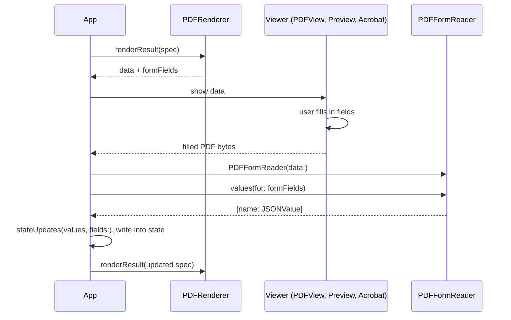

import { Aside } from "@astrojs/starlight/components";
import ComponentTable from "../../../components/ComponentTable.astro";

A PDF spec can contain form fields that the reader fills in inside a PDF viewer. This page documents the six form components, how the renderer draws, names and paginates them, the validator rules that apply to them, and what the common viewers do with the result. [Make a Fillable PDF](/pdf/fillable-quick-start/) is the step-by-step tutorial.

## What a fillable PDF is

A fillable PDF carries an AcroForm: a set of named fields with widget annotations placed on the pages. A viewer such as Preview, PDFKit's `PDFView` or Acrobat lets the reader type into text fields, tick checkboxes and pick options, and stores the values in the file when it is saved. The values travel with the PDF, so another program can read them back.

`JSONRenderPDF` draws the page content as usual (labels, the white field boxes, everything else in the spec) and then adds the AcroForm to the same file: one field per form component, with its name, flags, options, current value and an appearance stream that shows that value. [`PDFRenderResult.formFields`](/api/swift/pdf-render-result/) lists the fields it wrote, and [`PDFFormReader`](/api/swift/pdf-forms/) reads a filled copy back into JSON.

## Components

<ComponentTable catalog="pdf-forms" />

`FieldSet` renders its `children`. The five field components are leaves and use `"children": []`. All six take `name`, which builds the field's [PDF name](#field-names). The fields also share:

| Prop | Effect |
|---|---|
| `label` | Drawn as static text: above the widget for `TextInput`, `RadioGroup`, `Select` and `ListBox`, to the right of the box for `Checkbox` (where it is required). It also becomes the field's tooltip (`/TU`). Emoji are removed and whitespace is collapsed, as for every text prop. |
| `required` | Only `true` counts. Sets the PDF Required flag. The renderer and `PDFFormReader` don't enforce it; some viewers mark or check required fields. |
| `readOnly` | Only `true` counts. Sets the PDF ReadOnly flag, so viewers show the value but don't let the reader change it. |

Optional props are `.nullable()`: omitting one and writing `null` mean the same thing.

## FieldSet

<ComponentTable catalog="pdf-forms" name="FieldSet" />

A `FieldSet` groups fields under an optional label and scopes their names: a `TextInput` named `email` inside a `FieldSet` named `applicant` is the PDF field `applicant.email`. FieldSets can nest.

- **Layout.** The label, then the children in a column with a 6 pt gap. The label is bold Helvetica in `#111827`, 11 pt for a top-level FieldSet and 10 pt for a nested one. With no `label` (or `""`) only the children are drawn.
- **In the PDF.** A non-terminal field whose kids are the fields and FieldSets inside it. A FieldSet with no written field below it is left out of the PDF.
- **Pagination.** Like a `View`: a FieldSet up to a third of the page's content height moves to the next page whole when it doesn't fit, and a taller one splits between its children.

```json
{
  "type": "FieldSet",
  "props": { "name": "applicant", "label": "Applicant" },
  "children": ["first-name", "email"]
}
```

## TextInput

<ComponentTable catalog="pdf-forms" name="TextInput" />

A single-line or multiline text field.

| Prop | Default | Behaviour |
|---|---|---|
| `value` | empty | The initial text. See [Initial values](#initial-values). |
| `placeholder` | none | A short format hint, such as `MM/DD/YYYY`, drawn in grey (`#9ca3af`) to the right of the label, above the box. It is never drawn inside the box and isn't part of the field's value. |
| `multiline` | `false` | `true` makes a multiline field (PDF Multiline flag). |
| `lines` | 3 | Visible lines of a multiline field, clamped to 1-40. Ignored when `multiline` isn't `true`. |
| `maxLength` | none | Clamped to 1-100,000. Written as `/MaxLen`, so viewers stop accepting characters at the limit. The initial `value` isn't shortened. |
| `password` | `false` | `true` sets the Password flag: viewers mask what the reader types, and the initial appearance draws one `*` per character. |
| `align` | `left` | `left`, `center` or `right` alignment of the text inside the box (`/Q`). |
| `fontSize` | 10 | Text size in points, clamped to 4-72. |
| `width` | full width | Width of the box in points, clamped to the available width. |

The box is 22 pt high, or `lines × 14 + 8` pt when multiline (50 pt for the default 3 lines). It is drawn white with a 1 pt `#9ca3af` border. The label is 9 pt `#374151`, 3 pt above the box.

```json
{
  "type": "TextInput",
  "props": {
    "name": "email",
    "label": "Email",
    "value": { "$state": "/applicant/email" },
    "placeholder": "name@example.com",
    "required": true
  },
  "children": []
}
```

## Checkbox

<ComponentTable catalog="pdf-forms" name="Checkbox" />

A yes/no box: a 12 pt square with the label in 10 pt `#111827` to its right, 6 pt apart and vertically centred. When it is on, the box shows a ZapfDingbats check mark.

| Prop | Default | Behaviour |
|---|---|---|
| `checked` | `false` | The box starts on only when this resolves to the boolean `true`. The string `"true"`, `1` and anything else leave it off. |
| `exportValue` | `"Yes"` | The PDF state name stored when the box is on. An empty string falls back to `"Yes"`. `"Off"` is [reserved](#reserved-values). |

`PDFFormReader` reads a checkbox back as `true` or `false`, whatever its export value.

```json
{
  "type": "Checkbox",
  "props": { "name": "consent", "label": "I agree to the terms", "checked": false, "required": true, "exportValue": "Agreed" },
  "children": []
}
```

## RadioGroup

<ComponentTable catalog="pdf-forms" name="RadioGroup" />

One choice from a few options, all visible. Each option is a 12 pt circle with its label in 10 pt to the right; the selected one shows a filled dot.

| Prop | Default | Behaviour |
|---|---|---|
| `options` | required | `[{ "label", "value" }]`. See [Options](#options). |
| `value` | none selected | The value of the selected option. A value that matches no option selects nothing. |
| `direction` | `vertical` | `vertical` stacks the options 4 pt apart. `horizontal` puts them in a row 14 pt apart that wraps onto more lines when it is too wide. |

In the PDF a radio group is one field with one widget per option, and it has the NoToggleToOff flag: clicking the selected option doesn't clear it. A `RadioGroup` with no usable options has no widgets and isn't written to the PDF or listed in `formFields`. The label and all the options move between pages together.

```json
{
  "type": "RadioGroup",
  "props": {
    "name": "status",
    "label": "Employment status",
    "options": [
      { "label": "Employed", "value": "employed" },
      { "label": "Self-employed", "value": "selfEmployed" },
      { "label": "Student", "value": "student" }
    ],
    "value": "employed",
    "direction": "horizontal"
  },
  "children": []
}
```

## Select

<ComponentTable catalog="pdf-forms" name="Select" />

A drop-down (PDF combo box) for one choice from a longer list. The box is 22 pt high and shows the selected option's label with a small grey chevron on the right.

| Prop | Default | Behaviour |
|---|---|---|
| `options` | required | `[{ "label", "value" }]`. See [Options](#options). |
| `value` | none | The selected option's value. A value that matches no option is still written and drawn as typed text. |
| `editable` | `false` | `true` sets the Edit flag, so the reader can type a value that isn't in the list. `PDFFormReader` accepts free text only from editable selects. |
| `width` | full width | Width in points, clamped to the available width. |

```json
{
  "type": "Select",
  "props": {
    "name": "state",
    "label": "State",
    "options": [
      { "label": "California", "value": "CA" },
      { "label": "New York", "value": "NY" }
    ],
    "value": "CA",
    "width": 140
  },
  "children": []
}
```

## ListBox

<ComponentTable catalog="pdf-forms" name="ListBox" />

A list of options shown in a box, with one or (with `multiSelect`) several selected. The static bulleted list of the document catalog is [`List`](/pdf/catalog/#list); this is the choice field.

| Prop | Default | Behaviour |
|---|---|---|
| `options` | required | `[{ "label", "value" }]`. See [Options](#options). |
| `value` | none | One option value, or an array of option values. |
| `multiSelect` | `false` | `true` sets the MultiSelect flag. The value is then an array. |
| `rows` | options count, 1-6 | Visible rows, clamped to 1-40. The box is `rows × 14 + 6` pt high and spans the full available width. |

The text is 10 pt, reduced (down to 6 pt) so that every option fits the box, because PDFKit and Preview draw all options without scrolling. The appearance stream highlights each selected row in light blue.

```json
{
  "type": "ListBox",
  "props": {
    "name": "languages",
    "label": "Languages",
    "options": [
      { "label": "English", "value": "en" },
      { "label": "Spanish", "value": "es" },
      { "label": "French", "value": "fr" }
    ],
    "value": ["en"],
    "multiSelect": true,
    "rows": 3
  },
  "children": []
}
```

## Options

`RadioGroup`, `Select` and `ListBox` take `options`, an array of `{ "label": string, "value": string }`. `value` is the export value: it is written to the PDF and is what `PDFFormReader` returns. `label` is what the reader sees.

The renderer normalises the array before drawing:

- A numeric `value` is converted to a string like JavaScript `String(value)`. An option whose `value` is missing or of another type is dropped. (The catalog schema only allows strings.)
- A repeated `value` is dropped; the first option with it wins.
- A missing or `null` `label` shows the value.

## Initial values

A field's starting value comes from its `value` prop (`checked` for `Checkbox`). Like every prop it can be a literal or an expression: `$state`, `$template`, `$cond`, and inside a `repeat` also `$item`, `$index` and `$bindItem`. The renderer resolves it before layout and converts the result:

| Component | Accepted | Anything else |
|---|---|---|
| `TextInput`, `RadioGroup`, `Select` | A non-empty string. Numbers and booleans are converted like `String(value)`, so `7800` becomes `"7800"`. | Empty: `null`, `""`, objects and arrays. |
| `Checkbox` | The boolean `true`. | Off. |
| `ListBox` | A string, or the first item of an array. | Nothing selected. |
| `ListBox` with `multiSelect` | An array of strings (numbers and booleans converted, other items dropped), or a single string as a one-item array. | No selections. |

The renderer doesn't check values against the options. A radio value that isn't an option selects nothing; a select or list value that isn't an option is still written, and `PDFFormReader` then drops it when reading. The validator reports literal values that aren't options; values from expressions are only known at render time.

### Bound fields

When `value` (or `checked`) is `{ "$state": "/path" }`, `{ "$bindState": "/path" }` or, inside a repeat, `{ "$bindItem": "field" }`, the renderer records the state pointer in [`PDFFormFieldInfo.pointer`](/api/swift/pdf-forms/). `$bindItem` resolves to the item's absolute pointer, such as `/references/1/name`. That mapping is what lets you write the filled values back into state with `PDFFormReader.stateUpdates(_:fields:)`. A field whose value is a literal, a `$template`, a `$cond` or an `$item` has no pointer: its value still prefills the field and is read back, but there is nowhere to write it.

```json
{ "name": "hasPets", "label": "I keep pets", "checked": { "$state": "/household/hasPets" } }
```

## Field names

Every field and FieldSet has a partial name, and the PDF identifies a field by its fully qualified name: the names of the enclosing FieldSets and its own, joined with `.`.

- **Partial name.** `name`, trimmed of whitespace. A missing, `null` or blank name falls back to the element's key. A non-string name is converted like `String(value)`.
- **Qualified name.** `applicant` > `address` > `street` is `applicant.address.street`. A field outside any FieldSet is named by its partial name alone.
- **No dots.** Write names without `.`: the dot separates FieldSet levels, so a field named `a.b` reads like field `b` in FieldSet `a`. The validator rejects such names and empty names.
- **Unique.** Fields and FieldSets share one namespace: no two may have the same qualified name, and a field can't have the name of a FieldSet at the same level. A field may reuse a FieldSet's name at another level (`person.person` is fine). The validator reports duplicates as errors. The renderer doesn't fail: in document order, it renames a taken name to `name#2`, `name#3` and so on, and qualifies the fields of a renamed FieldSet under the new name.

```json
"applicant": { "type": "FieldSet", "props": { "name": "applicant" }, "children": ["address"] },
"address":   { "type": "FieldSet", "props": { "name": "address" }, "children": ["street"] },
"street":    { "type": "TextInput", "props": { "name": "street", "label": "Street" }, "children": [] }
```

The `street` field above is `applicant.address.street`.

### Names inside a repeat

A field inside a `repeat` is drawn once per item, so a literal name gives every copy the same name: the renderer then writes `name`, `name#2`, `name#3`, and the validator warns. Give each copy its own name with an expression that reads the item:

- A `$template` with a bare `${field}`, which reads the current item: `{ "$template": "guest_${id}" }`.
- `{ "$item": "id" }`, or `{ "$bindItem": "id" }`, which reads the same value.
- A FieldSet around the fields whose name varies per item, so the fields keep plain names. This is usually the clearest:

```json
"references": {
  "type": "Column",
  "props": { "gap": 8 },
  "repeat": { "statePath": "/references", "key": "id" },
  "children": ["reference"]
},
"reference": {
  "type": "FieldSet",
  "props": { "name": { "$template": "reference${id}" }, "label": { "$template": "Reference ${id}" } },
  "children": ["ref-name"]
},
"ref-name": {
  "type": "TextInput",
  "props": { "name": "name", "label": "Full name", "value": { "$bindItem": "name" } },
  "children": []
}
```

With two references whose ids are `1` and `2`, the fields are `reference1.name` and `reference2.name`, bound to `/references/0/name` and `/references/1/name`. `$template` can't interpolate `$index`, so name items by a field of their own.

## Reserved values

A checkbox's export value and a radio group's option values become PDF button state names, and the PDF reserves `Off` for the "off" state. The validator therefore rejects `"Off"` and `""` for a `Checkbox` `exportValue` and for `RadioGroup` option values (`reserved_value`). `Select` and `ListBox` values have no such limit.

The renderer still produces a working form when a spec uses them anyway. It gives such a state a different internal name (`Off_1`, and `On` for an empty radio value; a repeated state name gets `_1`, `_2`), and an empty checkbox `exportValue` becomes `"Yes"`. `PDFFormReader.values(for:)` maps the internal names back, so you get `"Off"` back for the option `"Off"`. Other software that reads the PDF sees the internal names.

## How fields paginate

Fields follow the [layout and pagination rules](/pdf/layout/) of the rest of the page, with fixed widget heights:

- A field's label and widget form one block that never splits: when it doesn't fit in the space left on a page, it moves to the next page whole. A `RadioGroup` keeps its label and every option together; a `Checkbox` keeps its box and label together.
- Widgets never split across pages, so every field has exactly one widget (one per option for a radio group) on one page.
- A `FieldSet` moves whole when it is at most a third of the page tall and doesn't fit; a taller one splits between its children.
- Put fields in `Row`, `Column` and `View`, for example two `View`s with `"flex": 1` in a `Row` for first and last name side by side. Don't put fields in a `Table`: its cells are text.
- A field whose widget is taller than a whole page's content area can't be placed. Its widget isn't drawn, and the field is missing from the PDF and from `formFields`. The result has no warning for this, so keep `lines` and `rows` small on small pages.
- Fields on pages beyond `PDFRenderer.Options.maxPages` aren't written and aren't listed in `formFields`.

## Validation

`validateSpec(_:catalog: .pdf)` on [`JSONRenderBridge`](/api/swift/json-render-bridge/), or `validateSpecForCatalog(pdfCatalog, spec)` in TypeScript, checks the form components' props against their Zod schemas and then runs these form rules:

| Code | Severity | Reported when |
|---|---|---|
| `invalid_field_name` | error | A `FieldSet` or field has a literal `name` that is `""` or contains `.`. |
| `duplicate_field_name` | error | Two fields, two FieldSets, or a FieldSet and a field have the same qualified name. Reported on the second one. |
| `repeated_field_name` | warning | A field inside a `repeat` has a qualified name that doesn't vary per item. |
| `reserved_value` | error | A `Checkbox` `exportValue` or a `RadioGroup` option `value` is `"Off"` or `""`. |
| `duplicate_option` | error | Two options of a `RadioGroup`, `Select` or `ListBox` have the same literal `value`. |
| `invalid_option_value` | error | A literal, non-empty `value` (or an item of a `ListBox` array) isn't one of the option values. Free text in an `editable` `Select` is allowed. |
| `invalid_option_value` | warning | A `ListBox` value is an array with more than one item but `multiSelect` isn't `true`. |

How the rules see the spec:

- The walk starts at `root` and follows `children`, like the renderer. Unreachable elements are ignored, and `visible` isn't evaluated, so a hidden field still takes part in the duplicate check.
- Outside a repeat, a `name` that is a `$state` or `$template` expression is resolved against `spec.state` for the duplicate check. A name that doesn't resolve to a string isn't checked.
- Inside a repeat, names are never compared. A name counts as varying per item when it (or an enclosing FieldSet's name) uses `$item`, `$index`, `$bindItem`, or a `$template` with a bare `${field}`. `${/absolute/path}` reads the same value for every item, so it doesn't count.

```swift
let report = try await bridge.validateSpec(spec, catalog: .pdf)
for issue in report.issues where issue.code == "duplicate_field_name" {
    print(issue.path ?? "", issue.message)
}
```

The PDF prompt teaches the model the same rules: camelCase names unique within their FieldSet, unique option values, never `"Off"`, prefill from `/state`, and per-item names in a repeat.

## The fill round trip



`values(for:)` treats the PDF as untrusted and returns only known fields whose stored value has the expected type: a string for text (cut to `maxLength`), `true` or `false` for a checkbox, an option value for a radio group or list, and free text only for an editable select. [PDF Form Fields](/api/swift/pdf-forms/) has the exact rules.

## Viewer notes

- **Appearances.** The AcroForm sets `/NeedAppearances true`, and every widget also gets an appearance stream with its current value (check marks, radio dots, text, the selected option, highlighted list rows). Viewers that regenerate appearances redraw the fields from the values; viewers that don't still show the prefilled values. The initial appearance uses Helvetica with Windows Latin 1 encoding, so characters outside that set are drawn as `?` until a viewer regenerates the appearance.
- **Saving in PDFKit and Preview.** When PDFKit saves an edited form, it rewrites the field tree its own way: button states can end up as strings in `/V` on the widgets, radio flags can move to the option widgets, and names can be flattened to full dotted names. `PDFFormReader` reads these forms as well as the standard one.
- **Multi-select lists before OS 27.** PDFKit before iOS 27 and macOS 27 drops multi-select list values when it saves.
- **List boxes in PDFKit.** PDFKit draws choice widgets itself and doesn't scroll list boxes, which is why the renderer shrinks list text to fit every option. It highlights only one selected row, so a multi-select list with several preselected values shows no highlighted row in `PDFView` and Preview. The PDF still carries every selection (the `/V` array, the `/I` indices and the highlighted appearance stream other viewers use), and `PDFFormReader` returns them all.
- **Text extraction.** PDFKit's text extraction (`PDFDocument.string`) can insert spaces between tightly kerned letters of labels. The drawn text is unaffected.
- **JSONRenderPDFView.** The preview's `PDFView` accepts input, but the view doesn't expose the edited document, and it re-renders (discarding edits) when the spec or options change. To read values back, keep the `PDFDocument` yourself and show it in your own `PDFView`, as [Make a Fillable PDF](/pdf/fillable-quick-start/) does.

<Aside>
`PDFDocument.dataRepresentation()` alone writes widgets without the catalog's `/AcroForm` and without radio-group parents, so `JSONRenderPDF` writes the form itself, as an incremental update appended to the drawn PDF. Re-saving the rendered PDF through PDFKit (for example after the user edits it) is fine: `PDFFormReader` reads both.
</Aside>

## Next

- [Make a Fillable PDF](/pdf/fillable-quick-start/): render, fill, read back and re-render, step by step.
- [Application Form](/pdf/examples/application-form/): a two-page form using every component.
- [PDF Form Fields](/api/swift/pdf-forms/): `PDFFormFieldInfo` and `PDFFormReader`.
- [PDFRenderResult](/api/swift/pdf-render-result/): `formFields` and the render warnings.
- [PDF Catalog](/pdf/catalog/): the document components around the fields.
