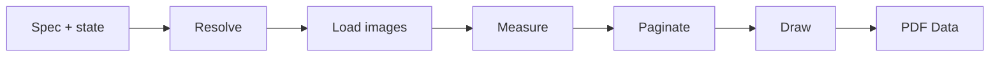

import { Card, CardGrid, LinkCard } from "@astrojs/starlight/components";
import Screenshot from "../../../components/Screenshot.astro";
import Screenshots from "../../../components/Screenshots.astro";

`JSONRenderPDF` is the second product of the Swift package. It takes a json-render spec built from the PDF catalog (invoices, reports, resumes, letters, statements) and renders it to PDF on the device, without a web view or a server. Documents can also contain fillable form fields that the reader completes in a PDF viewer. This section covers the catalog, layout and pagination, fillable forms, and six example documents.

## What it is

The model writes the same kind of spec as for forms: a flat element map with a `root`, plus `state`. The difference is the catalog. A PDF spec uses `Document`, `Page`, `View`, `Row`, `Column`, `Heading`, `Text`, `Image`, `Link`, `Table`, `List`, `Divider`, `Spacer` and `PageNumber`, and `PDFRenderer` turns it into PDF bytes:

```swift
import JSONRenderPDF
import JSONRenderSwiftUI

let data = try await PDFRenderer().render(spec)              // PDF bytes
let document = try await PDFRenderer().document(for: spec)   // PDFKit PDFDocument
```

| | |
|---|---|
| Product | `JSONRenderPDF`, in `swift/JSONRender/Package.swift`. Its target depends on `JSONRenderSwiftUI`. |
| Platforms | iOS 26, macOS 26 (tests run on both) |
| Drawing | Core Text for measurement and glyphs, a Core Graphics PDF context for output |
| Preview | `JSONRenderPDFView`, a SwiftUI wrapper around PDFKit's `PDFView` |
| Dependencies | None beyond the OS |

<Screenshots>
  <Screenshot name="pdf/invoice-page1.png" alt="An A4 invoice rendered by JSONRenderPDF" caption="invoice.json" width={300} />
  <Screenshot name="pdf/report-page1.png" alt="A quarterly report rendered by JSONRenderPDF" caption="report.json" width={300} />
</Screenshots>

## The catalog

The PDF catalog is defined in `packages/swift/src/pdf.ts`: 14 document components with Zod prop schemas (`pdfComponentDefinitions`), six fillable form components from `packages/swift/src/pdf-forms.ts`, and no actions. Its schema declares an optional top-level `state`, so validation keeps the data that `$state`, `$item` and `repeat` read. Its prompt template is written for static documents: it covers JSONL output, the components, `state`, `repeat`, `$item`, `$index`, visibility and editing, followed by rules on page structure, text, images, emoji and content density. The generated prompt is checked in as `docs/system-prompt-pdf.sample.txt`.

[PDF Catalog](/json-render-swift/pdf/catalog/) documents every document component and prop, and [Fillable Forms](/json-render-swift/pdf/forms/) the form components.

## What runs where

Work that runs once per prompt or stream chunk runs the json-render JavaScript in JavaScriptCore. Rendering is native Swift.

| JavaScriptCore (`JSONRenderBridge`) | Native Swift (`JSONRenderPDF`) |
|---|---|
| PDF system prompt: `systemPrompt(catalog: .pdf)` | Resolve `state`, expressions, `visible` and `repeat` |
| `buildUserPrompt`, for any catalog | Load images through `PDFImageLoader` |
| Stream compiler: `makeStreamCompiler()`, for any catalog | Measure text and lay out boxes |
| `validateSpec(_:catalog: .pdf)`, `autoFixSpec(_:catalog: .pdf)` | Paginate |
| `catalogManifest(catalog: .pdf)`, `jsonSchema(catalog: .pdf)` | Draw into a Core Graphics PDF context |

`JSONRenderBridge.Catalog` has two cases, `.swiftui` (the default, forms) and `.pdf`. Calls without `catalog:` target the forms catalog.

## The pipeline

`PDFRenderer.render(_:)` runs five stages. Pagination finishes before anything is drawn, so `PageNumber` knows the total page count.



1. **Resolve.** `spec.state` is merged with `PDFRenderer.Options.state` (top-level keys from the options win). Each element's `visible` is evaluated, props are resolved (`$state`, `$template`, `$cond`, `$item`, `$index`), `repeat` expands children once per array item, and missing children, unknown types and reference cycles are skipped.
2. **Load images.** Every distinct `Image` `src` is loaded concurrently through the injectable loader, each with a timeout (10 s by default). Failures become a grey placeholder box.
3. **Measure.** Components become boxes with their default styles, and the layout engine measures them in points, top-left origin. Text uses Helvetica metrics, Knuth & Plass line breaking and en-US hyphenation.
4. **Paginate.** Each `Page` element's flow is cut into page-sized fragments: text between lines, tables between rows with the header repeated.
5. **Draw.** Each fragment is drawn into a PDF page, links become URL annotations, and `PageNumber` text is filled in. When the spec has form components, their fields are then added to the PDF as an AcroForm.

[Layout and Pagination](/json-render-swift/pdf/layout/) has the exact rules.

## Features

<CardGrid>
  <Card title="14 document components" icon="document">
    Pages in six paper sizes, boxes, rows and columns, headings, text, images, links, tables, lists, dividers, spacers and page numbers.
  </Card>
  <Card title="Data-driven documents" icon="seti:json">
    `state`, `$state`, `$template`, `$cond`, `visible`, and `repeat` with `$item` and `$index`, through the same runtime as the forms renderer.
  </Card>
  <Card title="Typography" icon="pencil">
    The Helvetica family with exact AFM metrics and kerning, optimal line breaking and en-US hyphenation.
  </Card>
  <Card title="Pagination" icon="list-format">
    Paragraphs split between lines, rows stay together, tables repeat their header on continuation pages, page numbers know the total.
  </Card>
  <Card title="Streaming preview" icon="rocket">
    Partial specs render without throwing. `JSONRenderPDFView` keeps the last document and the reader's page while a new render runs.
  </Card>
  <Card title="Images and links" icon="external">
    An injectable async image loader with a timeout, budgets and a placeholder, `objectFit`, and PDF link annotations for `Link`.
  </Card>
  <Card title="Fillable forms" icon="approve-check">
    Text inputs, checkboxes, radio groups, selects and list boxes become real AcroForm fields, prefilled from state and read back with `PDFFormReader`.
  </Card>
</CardGrid>

## PDF and forms

| | Forms (`JSONRenderSwiftUI`) | PDF (`JSONRenderPDF`) |
|---|---|---|
| Catalog | `@json-render/swift`, 15 components, 7 actions | `pdfCatalog`, 14 document components and 6 form components, no actions |
| Output | Live SwiftUI views | A static PDF, re-rendered when the spec changes |
| State | Read and written by inputs (`$bindState`) | Read by the renderer. Values typed into [form fields](/json-render-swift/pdf/forms/) are read back from the saved PDF and written into state by your app. |
| Events, actions, watchers, validation checks | Yes | None |
| `repeat`, `$item`, `$index` | Not supported | Supported |
| Entry point | `FormSession` + `JSONRenderView` | `PDFRenderer` or `JSONRenderPDFView` |

Both use the same `Spec` type, the same expression and visibility runtime, and the same stream compiler.

## Next

<CardGrid>
  <LinkCard title="Generate your first PDF" href="/json-render-swift/pdf/quick-start/" description="Render a spec, preview and share it, drive it from state, then stream one from an LLM." />
  <LinkCard title="PDF catalog" href="/json-render-swift/pdf/catalog/" description="Every component, its props, defaults and behaviour." />
  <LinkCard title="Layout and pagination" href="/json-render-swift/pdf/layout/" description="Sizing, text layout, and where pages break." />
  <LinkCard title="Fillable forms" href="/json-render-swift/pdf/forms/" description="Form fields in a PDF, and reading the filled values back." />
  <LinkCard title="PDF examples" href="/json-render-swift/pdf/examples/" description="Six complete documents with their specs." />
</CardGrid>
