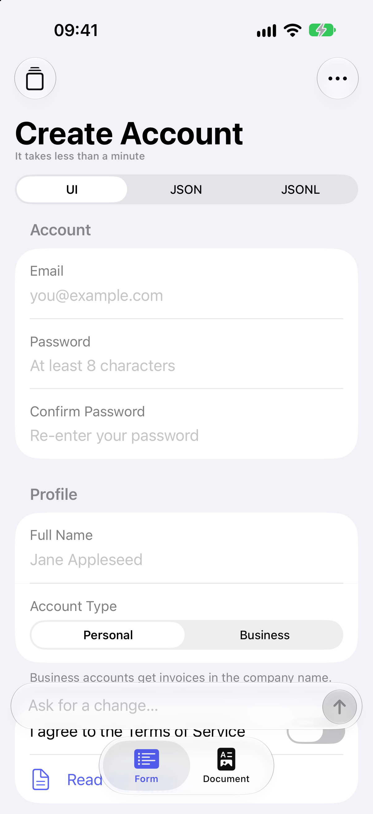
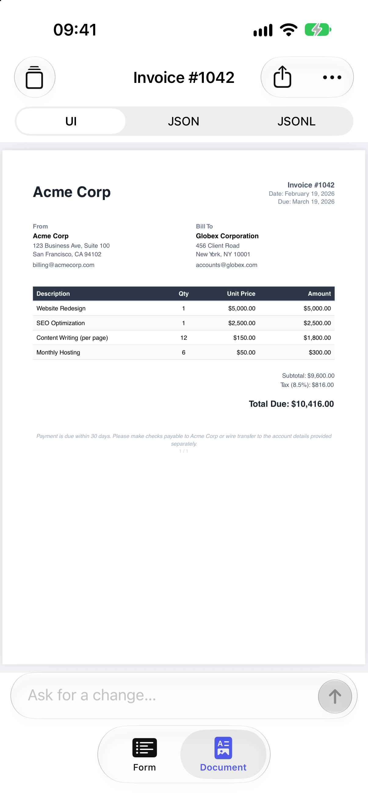

# FormDemo

An iOS 26 SwiftUI app with two modes, switched with the tab bar:

- **Form** asks an AI model (OpenAI or Claude, chosen in Settings) for a form. It streams the model's JSONL patches through the
  `JSONRenderSwiftUI` stream compiler and renders the form live with native controls.
- **Document** does the same with the PDF catalog and shows a live PDF preview (`JSONRenderPDF`),
  which you can share as a file.

In both modes, follow-up prompts edit the current spec. Offline examples and a recorded stream work
without an API key.




## Run

Requirements: Xcode 27, XcodeGen (`brew install xcodegen`), an iOS 26+ simulator.

```sh
cd ios
xcodegen generate                      # project.yml -> FormDemo.xcodeproj
open FormDemo.xcodeproj                # run the FormDemo scheme
# or from the command line:
xcodebuild -project FormDemo.xcodeproj -scheme FormDemo \
  -destination 'platform=iOS Simulator,name=iPhone 18 Pro,OS=27.0' build test
```

The project uses the SDK through a local Swift package (`../swift/JSONRender`, products
`JSONRenderSwiftUI` and `JSONRenderPDF`). The offline examples are app resources referenced in place,
not copied:

- `../fixtures/specs`: the four form specs and `registration.jsonl`.
- `../fixtures/pdf`: six document specs (including the fillable `application-form`), plus
  `statement.jsonl` and `application-form.jsonl`. `reference/` is excluded.

## Providers, API keys and models

Settings → **Provider** chooses **OpenAI** or **Claude** for both modes. Until you pick one, the app
uses OpenAI, unless only a Claude key is configured. The choice is read when a generation starts,
so switching mid-stream doesn't affect the running request.

| | OpenAI | Claude |
|---|---|---|
| Endpoint | `POST https://api.openai.com/v1/responses` | `POST https://api.anthropic.com/v1/messages` |
| Client | `OpenAIClient` | `AnthropicClient` (raw URLSession + SSE; there is no official Swift SDK) |
| Models | `gpt-6-astra`, `gpt-6.1-sol`, `gpt-6-luna` (default), Custom… | Claude Fable 5 (`claude-fable-5`), Opus 5.5 (`claude-opus-5-5`), Sonnet 5.5 (`claude-sonnet-5-5`, default), Haiku 5.5 (`claude-haiku-5-5`), Custom… |
| Effort | Model default, low/medium/high (unverified for these IDs) → `reasoning.effort` | Model default, low/medium/high/xhigh/max → `output_config.effort` (low or medium recommended) |
| Key | Keychain item `openai-api-key`, else `OPENAI_API_KEY` | Keychain item `anthropic-api-key`, else `ANTHROPIC_API_KEY` |

Model, effort and Custom… model IDs are saved per provider (UserDefaults). *Model default* sends no
effort parameter. A saved effort the provider doesn't offer resets to Model default.

The Claude request is `model`, `max_tokens: 64000` and `stream: true`, plus:

- `system`: one text block holding the bridge's system prompt, with `cache_control: {type: "ephemeral"}`.
- `messages`: a single user message holding the `buildUserPrompt` output.
- Optionally `output_config.effort`.

It never sends `thinking`, `temperature`, `top_p`, `top_k` or an assistant prefill, because the
current models reject them. `claude-opus-5-5` and `claude-sonnet-5-5` also send `fallbacks: "default"`
with `anthropic-beta: server-side-fallback-2026-07-01` (server-side refusal fallback); other models
send neither.

Keys are looked up when each request starts:

1. **Settings → <provider> API key → Save to Keychain**. One Keychain item per provider, on this
   device.
2. Otherwise the provider's environment variable. When you run from Xcode, the shared scheme sets
   `OPENAI_API_KEY` / `ANTHROPIC_API_KEY` to `$(OPENAI_API_KEY)` / `$(ANTHROPIC_API_KEY)`. These are
   build settings read from an untracked file:

   ```sh
   cat > ios/Secrets.xcconfig <<'KEYS'    # git-ignored (ios/.gitignore)
   OPENAI_API_KEY = sk-...
   ANTHROPIC_API_KEY = sk-ant-...
   KEYS
   ```

   `FormDemo.xcconfig` (tracked) defines empty defaults and uses `#include?` to read
   `Secrets.xcconfig`. Keys reach the app only through the scheme's run environment; they aren't
   compiled into the app. Don't paste keys into the scheme itself, because that file is committed.
   For `simctl` launches, use `SIMCTL_CHILD_ANTHROPIC_API_KEY=… xcrun simctl launch …`.

A missing key names the provider and where to set it.

Without a key, the **Examples** menu loads the fixture specs. Its recorded streams
(`registration.jsonl`; `statement.jsonl` and `application-form.jsonl`) play through the real compiler pipeline in
small chunks with short delays.

## Using the app

- **Form / Document tabs**: each mode is a separate workspace with its own controller. Switching
  keeps the other mode's spec, stream, banners and form input.
- **Prompt bar** (bottom, Liquid Glass): describe a form or document and send. While a stream runs,
  the button becomes **Stop**, which cancels the request and keeps the partial spec. When a spec is
  already showing, the prompt edits it. The empty state offers suggestion chips for each mode.
- **UI / JSON / JSONL**:
  - **UI** shows the rendered form, or the PDF preview. While a document streams, the preview
    re-renders at most every 0.5 s, so partial documents appear.
  - The PDF preview is **fillable**: tap a field of a fillable document (e.g. "Rental Application
    (fillable)") to type, check or choose.
  - It re-renders only when the spec or the document revision changes, so edits survive the end
    of a stream and switching tabs.
  - Clear, loading an example and starting a new document drop the cached PDF and its edits. A
    render that was superseded never replaces a newer document.
  - **JSON** shows the spec. For forms it also shows the live state, which updates as you type.
  - **JSONL** shows the raw model output of the latest stream.
- **Toolbar**:
  - Examples menu (offline specs, recorded streams).
  - **Read filled values** (fillable documents, when not streaming) reads the document as it is
    now, including your edits, with `PDFFormReader`. A sheet shows the values as JSON (fully
    qualified field names) and offers **Apply to state**. That writes every value whose field is
    bound to state (`$state`) into the spec's `state` through the render's pointer mapping, then
    re-renders. Filled fields without a binding are listed as not applied.
  - **Share PDF** (documents, when not streaming) shares a PDF file named after the resolved
    `Document.title`. For a fillable document it shares what you see: a snapshot of the previewed
    PDF, including fields you filled in, even ones not bound to state. Other documents are
    rendered from the spec.
  - The ⋯ menu holds Copy JSON, Clear and Settings.
- **Banners** above the prompt bar show errors and spec validation results; dismiss them with ×.
  Errors include a missing key, an HTTP status with the API's message, stream or decode failures, a
  model refusal, a reply with no patches, and a cut-off response. A cut-off response is OpenAI's
  `response.incomplete`, or Claude's `max_tokens` / `model_context_window_exceeded`; the patches
  that arrived are kept, and the run isn't treated as complete. Validation results include warnings and an
  "auto-fixed" notice.
- **Submit** (forms): the `submit` action runs only when every visible field passes its checks. The
  sheet then shows the submitted data and a **PDF** tab with a summary document, and **Export as PDF**
  shares it. A **Fillable PDF** tab previews the form as a fillable PDF, and the **Export** menu shares
  either file. The fillable export shares the previewed document, with your edits. The summary has
  the form title, the submission date, a table and page numbers.

  The submitted `data` is resolved exactly against the state pointer it came from. That pointer
  is the `$state` path of the spec's `submit` binding, e.g. `/form` for `{"data": {"$state": "/form"}}`;
  with several bindings, it is the one whose value equals the data. Fields outside that subtree
  weren't submitted: the summary leaves them out, and the fillable export uses their live values.
  The table has one row per visible submitted field (label → value;
  pickers show option labels, toggles Yes/No, dates formatted, passwords masked). A `$template` label
  that ends with the field's own value, such as "Guests: ${/form/guests}", drops that value.

  The fillable export (`FillablePDFMapper`) maps the SwiftUI spec to PDF form components, seeded
  with the submitted values:

  | SwiftUI | PDF |
  |---|---|
  | `TextField` / multiline | `TextInput` / `TextInput` with `multiline` and `lines` |
  | `SecureField` | `TextInput` with `password`, never seeded |
  | `Toggle` | `Checkbox` |
  | `Picker` segmented / inline / wheel | `RadioGroup` (vertical) |
  | `Picker` menu / navigationLink / default | `Select` |
  | `DatePicker` | `TextInput` with a format hint in the label (`YYYY-MM-DD`, `HH:MM`, `YYYY-MM-DD HH:MM`) |
  | `Stepper`, `Slider` | `TextInput` with a range hint |
  | `Section` | `FieldSet` (named after the section) + `Heading`, footer `Text` |
  | `Text`, `LabeledContent` | `Text` |

  Hidden elements and buttons are omitted. `required` / `maxLength` checks carry over, and field
  names come from the bound pointer's last segment.

### Launch arguments (screenshots and demos)

| Argument | Effect |
|---|---|
| `-mode form\|document` | Initial mode (default `form`) |
| `-example <id>` | Load form `registration`, `event-rsvp`, `feedback-survey` or `shipping-address` |
| `-pdf-example <id>` | Load document `invoice`, `report`, `resume`, `letter`, `statement` or `application-form` |
| `-replay [id]` | Play a recorded stream of the initial mode (default: the first; documents also have `application-form`) |
| `-tab ui\|json\|jsonl` | Initial tab of the initial mode |
| `-validate` | Run form validation after loading (shows the inline errors) |
| `-submit` | Open the submission sheet with the current `/form` state. The submit action and its validation don't run, and the sheet says so |
| `-submit-pdf` / `-submit-fillable` | Like `-submit`, opened on the PDF summary / fillable PDF |
| `-demo-fill` | Type sample values into the document's text fields, as a user would (screenshots) |
| `-read-values` | Open "Read filled values" once the document has rendered |
| `-settings` | Open Settings |
| `-provider openai\|anthropic` | Override the provider for this launch (UserDefaults argument domain; not saved) |
| `-demo <id>` | Debug builds only: run the scripted walkthrough `FormDemo/DemoStreams/<id>.demo.json` (see below) |

```sh
xcrun simctl launch booted dev.jsonrender.FormDemo -mode document -pdf-example invoice
```

Screenshots are in [`docs/screenshots`](../docs/screenshots).

### Scripted demo (screen recordings)

`-demo rsvp` (Debug builds) plays a scripted walkthrough for screen recordings, such as the explainer video in
`video/`. It types a prompt into the prompt bar and answers it with a recorded stream through the real
pipeline, shown as a normal generation. A second prompt then replays an edit stream on top of the current
spec, as an edit would. After that it types values into the form state, blurs the email field to show its
validation error, fixes it, and submits `/form`, which opens the submission sheet on the **Fillable PDF** tab.

The files are in `FormDemo/DemoStreams/` and are generated by `video/scripts/make_demo_streams.py` from
`fixtures/specs/event-rsvp.json`:

- `rsvp-demo.jsonl` is a trimmed RSVP form.
- `rsvp-demo-edit.jsonl` adds the dietary fields and makes email required.
- `rsvp.demo.json` holds the steps.

```sh
xcrun simctl io <udid> recordVideo --codec h264 /tmp/demo.mp4 &
xcrun simctl launch <udid> dev.jsonrender.FormDemo -demo rsvp
```

## Architecture

```
FormDemo.xcconfig              OPENAI_/ANTHROPIC_API_KEY defaults + #include? "Secrets.xcconfig" (untracked)
FormDemo/
  App/
    FormDemoApp.swift          wires AppSettings + both clients (picked per provider) into AppModel
    LaunchOptions.swift        -mode / -example / -pdf-example / -replay / -tab / ...
  Models/
    AppModel.swift             selected mode + one GenerationController per mode
    GenerationKind.swift       form | document: catalog, prompt rules, host actions, examples, copy
    GenerationController.swift @Observable pipeline: prompt -> stream -> compiler -> spec -> validate
    SubmissionSummary.swift    form spec + state -> summary PDF spec
    FillablePDFMapper.swift    form spec + submitted data -> fillable PDF form spec
    PDFPreviewModel.swift      owns the previewed PDFDocument (edits), renders on spec change, reads values
    ExampleSpec.swift          bundled fixtures (specs + replay streams)
    ViewMode.swift
  Services/
    TextGenerating.swift       protocol TextGenerating, GenerationRequest, TextStreamEvent (.text / .servingModelChanged)
    Provider.swift             openai | anthropic: models, defaults, efforts, key names
    OpenAIClient.swift         Responses API request, URLSession.bytes, SSE -> text deltas
    AnthropicClient.swift      Messages API request (+ AnthropicRequestBody), SSE -> text / serving-model notes
    AnthropicStreamEvent.swift text_delta, fallback block, stop reasons, message_stop, error, ping
    AnthropicError.swift       HTTP mapping (401/429/529/5xx), refusal, cut off / context window, stream errors
    SSEParser.swift            incremental text/event-stream parser (byte-level, chunk-safe)
    ResponsesStreamEvent.swift output_text.delta, refusal.delta/done, completed, failed, incomplete, error
    OpenAIError.swift          user-facing errors
    PDFExport.swift            Transferable: renders a spec to "<Document.title>.pdf" on demand
    KeychainStore.swift, AppSettings.swift   provider; per-provider key (Keychain), model + effort (UserDefaults)
    ReplayStream.swift         deterministic token-sized chunks for the offline replay
  Views/
    RootView.swift             TabView: Form | Document
    WorkspaceView.swift        one mode's screen: toolbar, tabs, canvas, prompt bar, sheets
    DocumentPreview.swift      fillable PDFView of PDFPreviewModel's document (0.5 s throttle while streaming)
    FilledValuesSheet.swift    values read from the filled PDF + "Apply to state"
    PromptBar.swift, Banners.swift, EmptyStateView.swift, CodeView.swift,
    SettingsView.swift, SubmissionSheet.swift
    ProminentFormButton.swift  custom component override
FormDemoTests/                 Swift Testing: SSE, OpenAI + Anthropic clients, settings,
                               form + document pipelines, mode isolation, summary PDF, export
```

### Generation pipeline (`GenerationController`)

One controller class serves both modes. `GenerationKind` supplies the bridge catalog: `.swiftui`
for forms and `.pdf` for documents. Forms render through a `FormSession`; a document is held as a
bare `Spec`.

1. Build the request. The provider, model and effort are read once, synchronously, and the client
   for that provider is chosen through `TextGenerating`.
   - `instructions` = `bridge.systemPrompt(customRules:catalog:)`, cached per controller. The form
     rules tell the model about the app's `log` action.
   - `input` = `bridge.buildUserPrompt(prompt, currentSpec:, state:)`. When a spec is already
     showing, it is passed in, which puts core's prompt into edit mode. Forms also pass the live
     state, which holds user input; a document's state lives in its spec.
2. Stream into the compiler:
   - The run checks that it is still current (not stopped, cleared or superseded) when it starts
     and again right before `streamText`, so a run cancelled early never opens an HTTP request.
   - The compiler starts from the current spec for edits, or from an empty spec for a new one.
   - Each text delta is appended to the raw JSONL and pushed into `SpecStreamCompiler`, and every
     push that applies patches updates the spec. Form values the user has typed survive, because
     the SDK merges streamed state.
   - A Claude `fallback` content block (`.servingModelChanged`) only notifies. While streaming, the
     fallback model continues the existing output, so the controller keeps the compiler,
     including a partially received JSONL line, the raw text, the patch count and the spec. A
     toast reads "Continued on <model>".
3. On Stop, cancellation or an error, `compiler.dispose()` frees the JS compiler without flushing,
   and the partial spec stays. On success, `compiler.finish()` flushes a trailing line without a
   newline, which can apply one more patch.
4. When the stream completes, the run must have applied at least one patch, counting one flushed
   by `finish()`. Otherwise the user is told the model returned no form or document, or didn't
   change the current one. A refusal is reported as "The model declined: …": OpenAI's
   `response.refusal.*`, or Claude's `stop_reason: "refusal"`, which uses `stop_details.explanation`.
   A cut-off response is an error that keeps the published patches and skips validation:
   Claude's `max_tokens` or `model_context_window_exceeded`, or OpenAI's `response.incomplete`.
5. After a successful run, `bridge.validateSpec(_:hostActions:catalog:)` runs. The form host
   actions are passed in, so `log` doesn't produce `unknown_action` warnings. If the spec is
   invalid, `autoFixSpec(_:catalog:)` runs, and the fix is kept when it reduces the error count.
   Issues and the auto-fix notice show in a dismissable banner.

Each run gets an ID, so a stopped or superseded run can't write to newer state. Replay goes through
the same code path with `ReplayStream` as the text source.

### SDK hooks used

- `.onJSONRenderAction("submit")` opens the submission sheet. `.onJSONRenderAction("log")` is a
  custom action that shows a toast and prints the params.
- `.jsonRenderComponent("Button")`: `borderedProminent` buttons render as a full-width
  `.glassProminent` call to action. Other styles fall back to `ComponentRegistry.standard`.
- `JSONRenderPDFView(spec:)` previews documents and form summaries. `PDFRenderer().render(_:)`
  produces the shared files.

## Tests

`FormDemoTests` is hosted by the app, so the bundled fixtures are available.

- **SSE parser**: typed events, any chunk size (1–12 bytes, including multi-byte UTF-8 split across
  chunks), LF/CRLF/CR, multi-line `data:`, comments and `retry`, unterminated final events, `[DONE]`.
- **Responses events**: text deltas, refusal delta and done, `response.completed`, `error` (flat
  and nested), `response.failed`, `response.incomplete`, the SSE event name as fallback type,
  malformed JSON.
- **OpenAI client**: request URL, headers and exact JSON body (`model`, `instructions`, `input`,
  `stream`, `store`, optional `reasoning`). Missing or blank keys. A stubbed `URLProtocol` covers
  streaming deltas, HTTP 401 with the API's error message, `response.failed`, refusals, and
  truncated streams.
- **Anthropic client**:
  - Request construction: the exact JSON body, including `cache_control`. No
    `thinking`/`temperature`/`top_p`/`top_k` and no prefill for any model or effort. `fallbacks` and
    the beta header only for Opus/Sonnet 5.5. Effort is omitted on Model default.
  - Missing key.
  - Event decoding and streaming: text deltas; thinking blocks and pings ignored; a fallback block
    yields `.servingModelChanged`; refusal with explanation; `max_tokens`;
    `model_context_window_exceeded`; mid-stream `error`; truncation.
  - HTTP error mapping: 401, 429 with `retry-after`, 529, 5xx and others.
- **Settings**:
  - Defaults are `gpt-6-luna` and `claude-sonnet-5-5`.
  - The default provider follows the configured keys.
  - Switching providers keeps each provider's model and effort; custom model IDs persist.
  - Per-provider keys; efforts the provider doesn't offer reset; Model default sends no `reasoning`.
- **Form pipeline** (mock `TextGenerating`):
  - `registration.jsonl` in token-sized chunks compiles to exactly `registration.json`.
  - The form builds progressively, and Stop cancels the underlying stream.
  - Stopping or superseding a run before it starts sends no request. With the real client and a
    counting `URLProtocol`, 20 such runs open no connections.
  - A refused edit and a prose-only edit are reported, and the form is left unchanged. An edit
    whose only patch is flushed by `finish()` succeeds.
  - Edit mode sends the current spec and state and keeps user input.
  - A fallback continues the output and shows "Continued on Claude Sonnet 5.5". This holds for
    new forms and edits, for a fallback in the middle of a JSONL line, and end to end through
    `AnthropicClient` with a stubbed stream (both patches applied).
  - Cut-off responses (Claude `max_tokens` and context window, OpenAI incomplete) are errors and
    keep the partial edit.
  - The provider is chosen when the run starts; switching mid-run doesn't affect it.
  - `autoFixSpec` repairs misplaced `visible`, and the banner can be dismissed.
  - Replay uses the same pipeline.
- **Document pipeline**:
  - `statement.jsonl` in chunks compiles to exactly `statement.json`, using the PDF system prompt.
    The result renders to a multi-page PDF.
  - Edit mode sends the current document.
  - "No document" is reported, and Stop keeps the partial document.
  - Every PDF example passes `validateSpec(catalog: .pdf)`.
  - The export file is named from the resolved `$template` title.
- **Fillable PDF**:
  - The mapper covers every SwiftUI component type, visibility, seeded values (submitted data over
    state), unseeded passwords, numeric option tokens, date formats and template labels. The
    mapped spec passes `validateSpec(catalog: .pdf)`.
  - `formFields` names for the mapped registration form (6) and RSVP form (7, or 8 once a hidden
    field becomes visible).
  - Reader round trip through `PDFPreviewModel`: edit widgets with PDFKit, read the values back,
    and confirm a second `show` of the same spec keeps the edits. Then apply to state and
    re-render: the values persist.
  - A render held at a slow image loader can't replace a newer document or its edits. A new
    revision or `reset()` drops cached edits. Share/export snapshots the edited document,
    including unbound fields, and falls back to rendering when the preview is outdated or has no
    fields.
  - `application-form.jsonl` compiles to exactly `application-form.json`.
- **Modes**: form and document controllers keep independent spec, stream, state and errors. Launch
  arguments parse.
- **Submission summary**:
  - Values come from the submitted `data`, not the live state, resolved against its exact root.
    With `/billing/email` and `/shipping/email` and only `/shipping` submitted, billing isn't
    reported, and an absent nested email isn't filled from a same-named field.
  - One row per visible submitted field, with option labels, Yes/No, masked passwords, and hidden
    fields skipped.
  - Template labels drop a trailing value placeholder.
  - The summary spec passes PDF validation and renders the title, labels and "Page 1 of 1".
  - The controller attaches the summary and marks `-submit` sheets as not validated.
